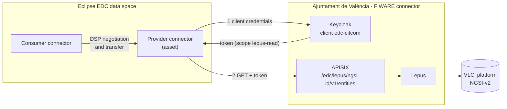

# Bridging both data spaces

The data of the Ajuntament de València lives in the FIWARE data space, but CitCom partners using the [Eclipse EDC data space](eclipse/index.md) should be able to use it too. Instead of copying the data, the same source is published in both.

## How it works

An EDC connector does not present verifiable credentials. To fetch an asset, its data plane calls a fixed HTTP address and authenticates with **OAuth2 client credentials**. The Ajuntament's FIWARE connector accepts exactly that on one dedicated route:

1. The asset in the EDC data space points to the Ajuntament's gateway and holds an OAuth2 client of the Ajuntament's Keycloak.
2. When a consumer has negotiated a contract for the asset, the provider's EDC data plane gets a token and reads the entities. The consumer receives them through EDC as usual.

The route is deliberately narrow:

- It accepts only tokens with its own scope, which no other client of the realm has. A token for this route does not work on the rest of the connector, and the credentials-based tokens of the FIWARE data space do not work on this route.
- It only allows `GET` on `/entities`, only for the entity types that are published, and with a rate limit.
- It always returns JSON-LD, so the `@context` travels with the data.

[Lepus](../toolbox/lepus.md) is the same instance used in the FIWARE data space: both data spaces read the same, live data.

## What is published

The Valencia datasets that Lepus serves can be published as EDC assets, one per entity type: `WasteContainer`, `AirQualityObserved` and `TrafficFlowObserved`. The bridge has been tested end to end: an EDC consumer negotiated a contract and downloaded the waste containers of Valencia through this route.

## Differences to keep in mind

| | FIWARE data space | EDC data space |
|---|---|---|
| Who is the consumer for the Ajuntament? | Each organisation, by its DID | The EDC connector that holds the asset |
| Access rules | ODRL policy per purchase, enforced by the Ajuntament's connector | Contract policy in EDC; the Ajuntament's route only knows the client |
| Queries | Any NGSI-LD query | The fixed address of the asset |

In other words, in the EDC data space the access control between consumers happens in EDC. The Ajuntament's connector only trusts the EDC asset as a whole.
