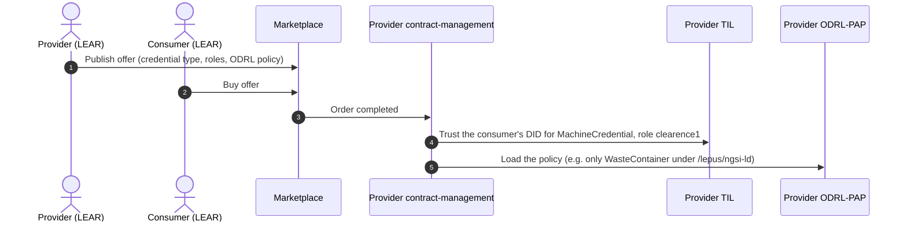
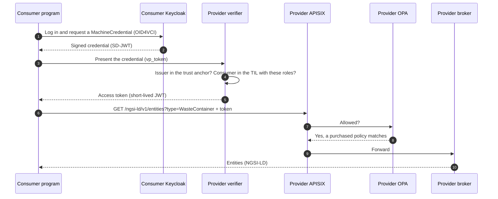
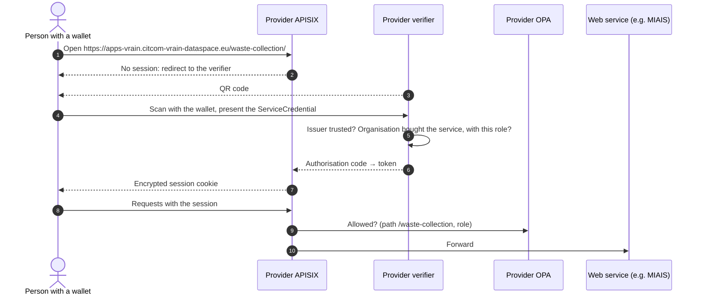

# How the data space works

The CitCom.ai Data Space is operated by VRAIN-UPV for the whole of CitCom and uses the [FIWARE Data Space Connector](https://github.com/FIWARE/data-space-connector) (version 10), which follows the recommendations of the [Data Spaces Business Alliance](https://data-spaces-business-alliance.eu/). This page describes its parts, the deployment running today and the four flows that make it work.

## Shared services

**Trust anchor**
:   Keeps the **Trusted Issuers Registry** (TIR): the list of organisations whose credentials are trusted in the data space, by their decentralised identifier (`did:web:…`). A verifier rejects any credential issued by an organisation that is not in it.

**Onboarding portal**
:   Where an organisation asks to join. Its legal representative (LEAR) registers the organisation; once approved, it is added to the trust anchor, and the LEAR acts for it with a `LegalPersonCredential`.

**Marketplace**
:   The catalogue of offers, built on the [TM Forum](https://www.tmforum.org/) APIs and the [BAE](https://github.com/FIWARE-TMForum/Business-API-Ecosystem) frontend. The LEAR of each organisation logs in with a wallet, sets up the organisation's profile, publishes offers and buys them. See [Marketplace](../marketplace/index.md).

## The deployment today

  

    
Operated by VRAIN-UPV for the whole data space

    

      <a class="cc-infra__svc" href="../../guides/join/">
        <strong>Onboarding portal</strong>
        <small>Organisations join</small>
      </a>
      <a class="cc-infra__svc" href="#shared-services">
        <strong>Trust anchor</strong>
        <small>Trusted Issuers Registry</small>
      </a>
      <a class="cc-infra__svc" href="../../marketplace/">
        <strong>Marketplace</strong>
        <small>Catalogue, offers, orders</small>
      </a>
    

  

  

    
1<small>The onboarding portal registers each organisation in the trust anchor</small>

    
2<small>Each connector publishes offers in the marketplace</small>

    
3<small>On purchase, the marketplace registers the contract in the provider's connector</small>

  

  

    <a class="cc-infra__part" href="../../valencia/">
      Provider
      <strong>Ajuntament de València</strong>
      <small>townhall-vlc. City data: VLCi + Lepus, Orion-LD</small>
      Connector
    </a>
    

      4
      
      <small>Reads the waste containers (MachineCredential)</small>
    

    <a class="cc-infra__part" href="../../miais/">
      Consumer
      <strong>VRAIN-UPV</strong>
      <small>vrain. AI service: MIAIS</small>
      Connector
    </a>
  

  

    

      
      5<small>People log in (ServiceCredential)</small>
      <a class="cc-infra__part cc-infra__part--plain" href="../../toolbox/wallets/">
        People
        <strong>Wallets</strong>
        <small>atesta-id-wallet, Lissi</small>
      </a>
    

  

- Each participant runs its own **connector**. The diagram shows the first two: the Ajuntament de València, which provides city data, and VRAIN-UPV, which provides an AI service and consumes city data. Both are described as worked examples: [Valencia](../valencia/index.md) and the [MIAIS](../miais/index.md). New participants join the same way.
- The MIAIS reads the waste containers of Valencia through the Ajuntament's connector, after buying the offer in the marketplace. People from other organisations use the MIAIS by logging in with their wallet.

The public services are:

| Service | URL |
|---|---|
| Marketplace | <https://marketplace.citcom-vrain-dataspace.eu> |
| Onboarding portal | <https://onboarding.citcom-vrain-dataspace.eu> |
| Trust anchor (TIR) | <https://tir.citcom-vrain-dataspace.eu/v4/issuers> (list of trusted organisations) |
| Connector of a participant `
` | `https://apisix-
.citcom-vrain-dataspace.eu` (data and services), `https://keycloak-
…` (credentials), `https://verifier-
…` (tokens) |

## Inside a connector

Every participant runs the same set of components:

  

    

      Consumer
      <strong>A program or a person</strong>
      <small>With a MachineCredential or a ServiceCredential</small>
    

  

  

    
1<small>It presents its credential to the Verifier and gets an access token</small>

    
2<small>It sends the request with the token to APISIX</small>

  

  

    
Connector of a participant

    
Access: who gets in

    

      
<strong>Verifier</strong><small>Credential → token (OID4VP)</small>

      
<strong>APISIX</strong><small>Gateway: checks the token, asks OPA</small>

      
<strong>NGSI-LD broker</strong><small>The data: Scorpio, Orion-LD, Lepus</small>

    

    
Rules: what they can do

    

      
<strong>Trusted Issuers List</strong><small>Who may access this connector</small>

      
<strong>OPA</strong><small>Allows or denies each request</small>

      
<strong>ODRL-PAP</strong><small>Stores the access policies</small>

    

    
Set-up: who is let in, and how

    

      
<strong>Keycloak</strong><small>Issues credentials to its people and programs (OID4VCI)</small>

      
<strong>contract-management</strong><small>Applies each purchase to the list and the policies</small>

    

  

  

    
3<small>When an order is completed, the marketplace notifies contract-management</small>

  

  

    

      Shared service
      <strong>Marketplace</strong>
      <small>Where the offers are bought</small>
    

  

| Component | Role |
|---|---|
| **Keycloak** | Identity server of the organisation. Issues `MachineCredential` and `ServiceCredential` to its programs and people with OpenID for Verifiable Credential Issuance (OID4VCI), as SD-JWT credentials. |
| **Verifier** | Receives credentials from consumers (OpenID for Verifiable Presentations), checks them against the trust anchor and the local trust list, and returns an access token. |
| **Trusted Issuers List** (TIL) | The organisations allowed to access *this* connector, per credential type and role. Filled in when someone buys an offer. |
| **APISIX** | The gateway in front of the data and services. Checks the token and asks OPA for a decision on every request. |
| **OPA + ODRL-PAP** | The policy engine. The PAP stores ODRL policies and turns them into rules for OPA, which allows or denies each request by organisation, path, entity type and method. |
| **contract-management** | Listens to the marketplace. When an order for one of this participant's offers is completed, it adds the buyer to the TIL and loads the offer's policy into the PAP. |
| **NGSI-LD broker** | The data itself. Scorpio comes with the connector; the Ajuntament also serves its data through Orion-LD and [Lepus](../toolbox/lepus.md). |

## Flows

### Join the data space

1. The organisation's LEAR registers it in the onboarding portal.
2. Once approved, the organisation's `did:web` is added to the trust anchor.
3. The LEAR logs in to the marketplace with a wallet and completes the organisation's profile. A provider also sets the address of its contract-management there, so purchases reach its connector.

The guide [Join the data space](../guides/join.md) has the details.

### Purchase an offer

An offer carries two settings: **which credential and roles** the buyer will be allowed to present, and **which policy** limits what the buyer can do. Both are applied automatically when the order completes; nobody configures the connector by hand.

### A machine reads data

This is how a program, such as the [MIAIS](../miais/index.md), reads data from another organisation. The library [ds-consumer-auth](../toolbox/ds_consumer_auth.md) does steps 1 to 5 for you.

If the consumer has not bought any offer, step 5 fails: the verifier does not find the consumer in its TIL. If it has bought an offer but not this dataset, step 8 fails: no policy allows that entity type. See [Use data from your code](../guides/consume_data.md).

### A person uses a web service

A provider can also offer a web application. People log in with a wallet instead of a password, and the provider's gateway does the login: the application needs no login code of its own.

The person's organisation must have bought the service, and the person must have the role the service asks for in their `ServiceCredential`. See [Publish a web service](../guides/publish_service.md).

## Where to go next

- [Valencia: a city platform](../valencia/index.md): a worked example of a city offering its data here.
- [Guides](../guides/index.md): join, read data, publish a dataset or a service.
- [Deploy your own connector](../guides/deploy_connector.md): how a connector is deployed.
