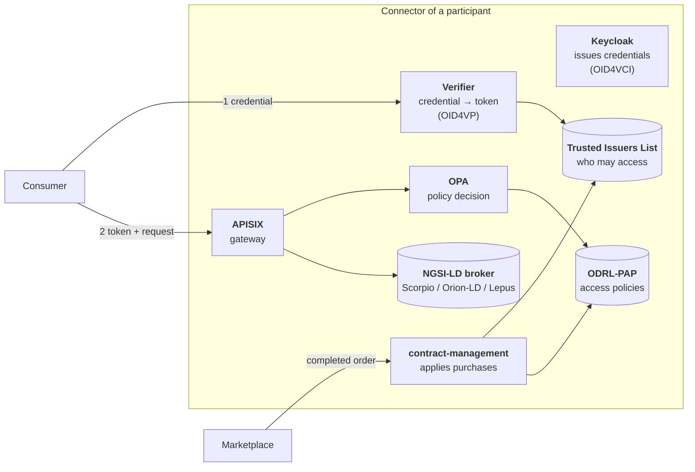
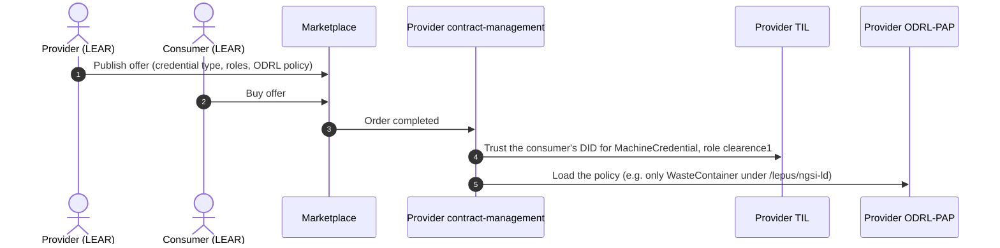
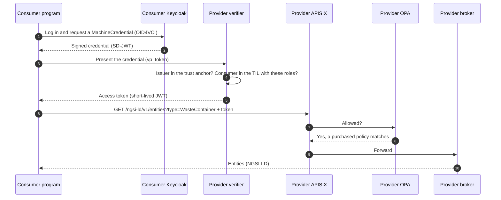
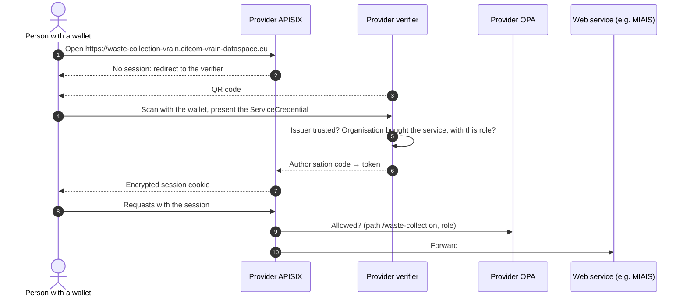

# FIWARE data space

The CitCom FIWARE data space runs on Kubernetes at the Valencia TEF node and uses the [FIWARE Data Space Connector](https://github.com/FIWARE/data-space-connector) (version 10), which follows the recommendations of the [Data Spaces Business Alliance](https://data-spaces-business-alliance.eu/). This page describes its parts and the four flows that make it work.

## Shared services

**Trust anchor**
:   Keeps the **Trusted Issuers Registry** (TIR): the list of organisations whose credentials are trusted in the data space, by their decentralised identifier (`did:web:…`). A verifier rejects any credential issued by an organisation that is not in it.

**Onboarding portal**
:   Where an organisation asks to join. Its legal representative (LEAR) registers the organisation; once approved, it is added to the trust anchor, and the LEAR acts for it with a `LegalPersonCredential`.

**Marketplace**
:   The catalogue of offers, built on the [TM Forum](https://www.tmforum.org/) APIs and the [BAE](https://github.com/FIWARE-TMForum/Business-API-Ecosystem) frontend. The LEAR of each organisation logs in with a wallet, sets up the organisation's profile, publishes offers and buys them. See [Marketplace](../marketplace/index.md).

## Inside a connector

Every participant runs the same set of components:

| Component | Role |
|---|---|
| **Keycloak** | Identity server of the organisation. Issues `MachineCredential` and `ServiceCredential` to its programs and people with OpenID for Verifiable Credential Issuance (OID4VCI), as SD-JWT credentials. |
| **Verifier** | Receives credentials from consumers (OpenID for Verifiable Presentations), checks them against the trust anchor and the local trust list, and returns an access token. |
| **Trusted Issuers List** (TIL) | The organisations allowed to access *this* connector, per credential type and role. Filled in when someone buys an offer. |
| **APISIX** | The gateway in front of the data and services. Checks the token and asks OPA for a decision on every request. |
| **OPA + ODRL-PAP** | The policy engine. The PAP stores ODRL policies and turns them into rules for OPA, which allows or denies each request by organisation, path, entity type and method. |
| **contract-management** | Listens to the marketplace. When an order for one of this participant's offers is completed, it adds the buyer to the TIL and loads the offer's policy into the PAP. |
| **NGSI-LD broker** | The data itself. Scorpio comes with the connector; the Ajuntament also serves its data through Orion-LD and [Lepus](../toolbox/lepus.md). |

## Flows

### Join the data space

1. The organisation's LEAR registers it in the onboarding portal.
2. Once approved, the organisation's `did:web` is added to the trust anchor.
3. The LEAR logs in to the marketplace with a wallet and completes the organisation's profile. A provider also sets the address of its contract-management there, so purchases reach its connector.

The guide [Join the data space](../guides/join.md) has the details.

### Purchase an offer

An offer carries two settings: **which credential and roles** the buyer will be allowed to present, and **which policy** limits what the buyer can do. Both are applied automatically when the order completes; nobody configures the connector by hand.

### A machine reads data

This is how a program, such as the [MIAIS](../miais/index.md), reads data from another organisation. The library [ds-consumer-auth](../toolbox/ds_consumer_auth.md) does steps 1 to 4 for you.

If the consumer has not bought any offer, step 5 fails: the verifier does not find the consumer in its TIL. If it has bought an offer but not this dataset, step 8 fails: no policy allows that entity type. See [Use data from your code](../guides/consume_data.md).

### A person uses a web service

A provider can also offer a web application. People log in with a wallet instead of a password, and the provider's gateway does the login: the application needs no login code of its own.

The person's organisation must have bought the service, and the person must have the role the service asks for in their `ServiceCredential`. See [Publish a web service](../guides/publish_service.md).

## Where to go next

- [Valencia TEF node](../valencia/index.md): the participants, data and services running today.
- [Guides](../guides/index.md): join, read data, publish a dataset or a service.
- [Deploy your own connector](../guides/deploy_connector.md): how a connector is deployed.
