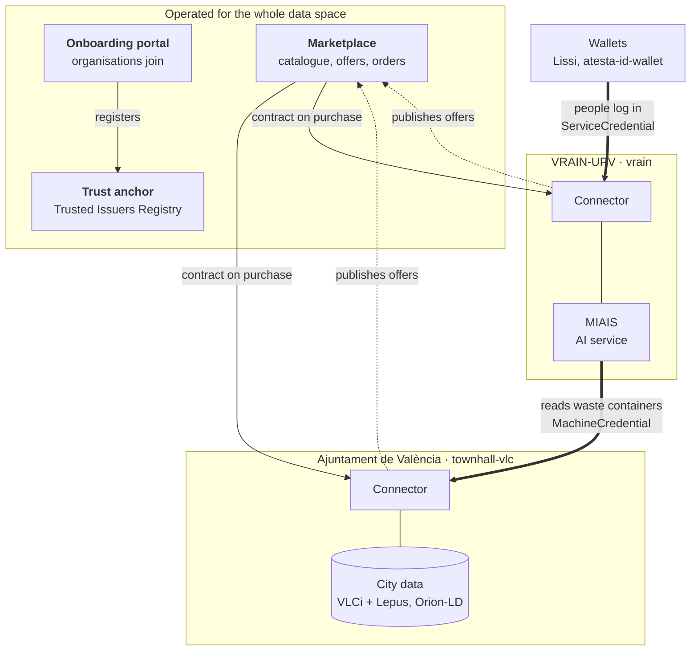

# The CitCom data spaces

CitCom runs two data spaces, built with the two main open-source technologies in Europe. Both follow the concepts in [Data spaces in 5 minutes](../getting_started/data_spaces.md); they differ in how identity and contracts work.

| | FIWARE data space | Eclipse EDC data space |
|---|---|---|
| **Technology** | [FIWARE Data Space Connector](https://github.com/FIWARE/data-space-connector) 10 | [Eclipse EDC](https://eclipse-edc.github.io/), sovity Community Edition |
| **Operated by** | VRAIN-UPV (Valencia TEF node) | A CitCom partner |
| **Identity** | Verifiable credentials (OID4VCI / OID4VP) and wallets | Connector identities managed by the operator's portal |
| **Contracts** | Marketplace (TMForum) → contract-management → trust list + ODRL policy | Dataspace Protocol (DSP) negotiation between connectors |
| **Data API** | NGSI-LD, served by the provider's connector | Any HTTP source, transferred by the connectors |
| **Entry point** | [marketplace.citcom-vrain-dataspace.eu](https://marketplace.citcom-vrain-dataspace.eu) | [citcom.dataspaceready.eu](https://citcom.dataspaceready.eu) |

-   :material-shield-key-outline:{ .lg .middle } __FIWARE data space__

    ---

    Components, and the flows to join, buy and access data and services.

    [:octicons-arrow-right-24: FIWARE data space](fiware.md)

-   :material-transit-connection-variant:{ .lg .middle } __Eclipse EDC data space__

    ---

    The alternative stack: architecture and deployment.

    [:octicons-arrow-right-24: Eclipse EDC data space](eclipse/index.md)

-   :material-bridge:{ .lg .middle } __Bridging both__

    ---

    How the Valencia data is also available in the EDC data space.

    [:octicons-arrow-right-24: Bridging both](bridge.md)

-   :material-map-marker-outline:{ .lg .middle } __Valencia TEF node__

    ---

    The data, services and participants running today.

    [:octicons-arrow-right-24: Valencia](../valencia/index.md)

## The FIWARE data space at a glance

- The **trust anchor**, the **onboarding portal** and the **marketplace** are shared by everyone.
- Each participant runs its own **connector**. Today there are two: the Ajuntament de València, which provides city data, and VRAIN-UPV, which provides an AI service and consumes city data.
- The **MIAIS** of VRAIN reads the waste containers of Valencia through the Ajuntament's connector, after buying the offer in the marketplace. People from other organisations use the MIAIS by logging in with their wallet.

The public services are:

| Service | URL |
|---|---|
| Marketplace | <https://marketplace.citcom-vrain-dataspace.eu> |
| Onboarding portal | <https://onboarding.citcom-vrain-dataspace.eu> |
| Trust anchor (TIR) | <https://tir.citcom-vrain-dataspace.eu/v4/issuers> (list of trusted organisations) |
| Connector of a participant `
` | `https://apisix-
.citcom-vrain-dataspace.eu` (data and services), `https://keycloak-
…` (credentials), `https://verifier-
…` (tokens) |
