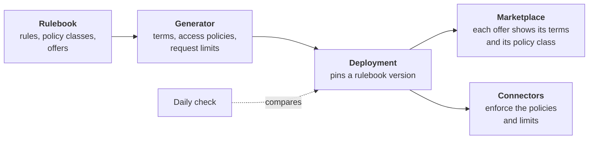

# Rulebook

The **rulebook** holds the rules that every participant of the CitCom.ai Data Space accepts when it joins: who governs the data space, how organisations join and leave, which agreements apply, what kinds of data can be offered, the terms of use of every offer, and the technical and security rules. It is written for every participant, technical or not, and follows the [DSSC Blueprint 3.0](https://blueprint.dssc.eu/).

[Read the rulebook](https://github.com/CitComAI-Hub/citcom-ds-rulebook/blob/main/rulebook/README.md){ .md-button .md-button--primary }

!!! note "Draft"
    The rulebook is a draft written by VRAIN-UPV. It becomes binding when the CitCom.ai consortium adopts a tagged version. Until then, the open decisions are listed at its end.

## What it contains

- **Governance**: the CitCom.ai consortium governs the data space; VRAIN-UPV operates the shared services (trust anchor, onboarding portal, marketplace) and is bound by neutrality rules.
- **Joining and leaving**: admission criteria, how access is removed when an organisation leaves or a purchase is cancelled.
- **Agreements**: joining means accepting the rulebook; buying an offer is the contract between provider and consumer.
- **Data categories**: open and shared data can be offered; confidential and personal data cannot, for now.
- **Policy classes**: every offer uses one class, which fixes its terms of use. There are three: `open-data`, `dataset-access` (shared data) and `service-access` (services).
- **Technical and security rules**: data is read only, follows [Smart Data Models](../toolbox/smart_data_models.md), and an offer reaches only the data it defines.

Every rule says how it is upheld: **enforced** (the software blocks what breaks it), **audited** (recorded and checked afterwards) or **contractual** (an obligation of the parties).

## How it reaches the data space

The rulebook is not only a document. The terms and conditions of every offer, its access policies and its request limits are **generated** from it, so an offer cannot contradict the rules.

1. A change (a rule, a class, an offer) is proposed in the rulebook repository and reviewed.
2. The generator turns each offer into its terms, its access policies and its request limits. Automatic tests check that every policy allows what its class allows, and nothing else.
3. The deployment of the data space pins that version of the rulebook and regenerates its offers.
4. The offers are published in the marketplace. When someone buys one, the provider's connector loads its policy.
5. Every day, a check compares the deployment with what the rulebook generates. The **in sync** badge above shows the result.

## Status

| Badge | Green means |
|---|---|
| **policies** | The generator works and every policy decides as its class says. |
| **in sync with deployment** | The deployment uses exactly what the rulebook generates. It turns red when the rulebook changes and the deployment has not taken the new version yet. |
| **version** | The rulebook version. *Draft* until the consortium adopts one. |

The check compares the rulebook with the deployment's configuration. The offers in the marketplace are compared with it by the operator after each publication.

## What it means for you

- **Providers** choose a policy class for each offer; they do not write their own terms or policies. See [Publish a dataset](../guides/publish_dataset.md) and [Publish a web service](../guides/publish_service.md).
- **Consumers** find the terms of an offer in the marketplace, with a link to its class in the rulebook. Buying an offer means accepting them.
- **Everyone** can propose a change: open an issue or a pull request in the [rulebook repository](https://github.com/CitComAI-Hub/citcom-ds-rulebook).
