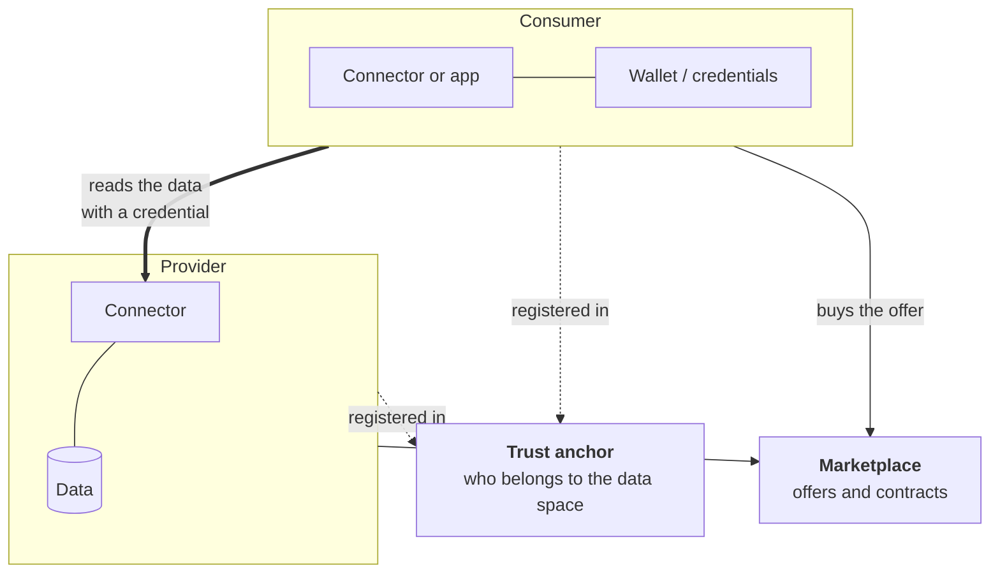

# Data spaces in 5 minutes

A **data space** is a set of rules and software that lets organisations share data while each one keeps control of its own. There is no central database: the data stays with its provider, and the provider decides who can read it and under which conditions.

This page explains the few concepts you need to follow the rest of the site. They apply to both CitCom data spaces; the [FIWARE data space](../data_spaces/fiware.md) page shows how they are implemented.

## The pieces

**Participant**
:   An organisation in the data space: a city council, a company, a university. In CitCom, for example, the Ajuntament de València (`townhall-vlc`) and VRAIN-UPV (`vrain`). A participant can be a **provider** (offers data or services), a **consumer** (uses them), or both.

**Trust anchor**
:   The list of participants that everyone trusts. When an organisation joins, the operator of the data space adds it to the trust anchor. From then on, the credentials it issues are accepted by the others.

**Connector**
:   The software each participant runs at its border. For a provider, it sits in front of the data: it checks who is asking, applies the access rules and only then forwards the request. In CitCom it is the [FIWARE Data Space Connector](../data_spaces/fiware.md) or an [Eclipse EDC](../data_spaces/eclipse/index.md) connector.

**Verifiable credential**
:   A digital certificate, signed by an organisation, that says something about a person or a machine: "this is an employee of VRAIN", "this program acts for VRAIN with the role `clearence1`". People keep theirs in a [wallet](../toolbox/wallets.md) on the phone or the desktop; programs request them from their organisation's identity server. CitCom uses three types:

    | Credential | Held by | Used to |
    |---|---|---|
    | `LegalPersonCredential` | the legal representative (LEAR) of an organisation | act for the organisation: join, buy, sell |
    | `MachineCredential` | a program | read data through an API |
    | `ServiceCredential` | a person | log in to a web service offered in the data space |

**Offer**
:   What a provider makes available: a dataset or a service, with a description, terms of use and the access rule it grants. Offers are published in the **marketplace**, where anyone can browse them.

**Contract and policy**
:   When a consumer buys an offer, a contract is created. The provider's connector then registers two things: that the consumer's credentials are now accepted, and an **access policy** (written in [ODRL](https://www.w3.org/TR/odrl-model/)) that says exactly what they can read, for example "only `WasteContainer` entities, only through this path".

## What happens when a consumer reads data

1. The consumer buys the offer in the marketplace. The provider's connector registers the contract.
2. The consumer's program gets a `MachineCredential` from its own organisation.
3. It presents the credential to the provider's connector and receives a short-lived access token.
4. It calls the data API with that token. The connector checks the policy and returns the data.

Nobody shares passwords, and the provider never creates accounts for consumers: trust comes from the trust anchor, and access from the contract. The [FIWARE data space](../data_spaces/fiware.md#flows) page shows these steps as diagrams.

## Why not just an API key?

An API key works between two organisations that already know each other. A data space works between many organisations that do not, and gives each provider:

- **sovereignty**: the data stays at home and the provider writes the rules;
- **traceability**: every access is tied to an organisation and a contract;
- **scale**: a new consumer does not need a new account or a new integration, only a purchase.

!!! info "Further reading"

    - [Data Spaces Support Centre](https://dssc.eu/): the European reference on data spaces and their building blocks.
    - [DS4SSCC](https://www.ds4sscc.eu/): data spaces for smart and sustainable cities and communities.
    - [FIWARE Data Space Connector](https://github.com/FIWARE/data-space-connector) and [Eclipse Dataspace Components](https://eclipse-edc.github.io/).
