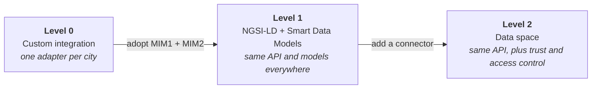

# Interoperability

Interoperability is what lets a service built for one city run in another city without a new integration. CitCom measures it with a simple ladder of three levels, built on the Minimal Interoperability Mechanisms.

## MIMs

The [Minimal Interoperability Mechanisms](https://mims.oascities.org/) (MIMs) are a small set of agreements, published by [Open & Agile Smart Cities](https://oascities.org/) (OASC), that cities adopt so their systems can talk to each other. They are *minimal* on purpose: a city does not replace its platform, it adds a common interface on top. CitCom uses two of them as its base:

| MIM | What it fixes | In CitCom |
|---|---|---|
| **MIM1 Context information management** | One API to read and write data about real-world entities | [NGSI-LD](https://www.etsi.org/deliver/etsi_gs/CIM/001_099/009/01.08.01_60/gs_cim009v010801p.pdf), served by a context broker (Orion-LD, Scorpio) |
| **MIM2 Data models** | One vocabulary to describe those entities | [Smart Data Models](https://smartdatamodels.org/), such as `WasteContainer` or `AirQualityObserved` |

## Interoperability levels

### Level 0: custom integration

There is no common standard. Each platform is connected with an integration written for it: its own API, its own field names, its own authentication. It works, but every new city means a new integration, and the data cannot be reused easily by others.

### Level 1: pivotal interoperability points

The platform exposes its data through **NGSI-LD** (MIM1) and describes it with **Smart Data Models** (MIM2). The platform can keep its own internals: what matters is that the interface is the same. A service written for level 1 reads waste containers in Valencia and in any other level-1 city with the same code.

What is still missing is *control*: a level-1 broker is usually either open to everyone or protected with an ad hoc key.

### Level 2: common interface with integrated security

The NGSI-LD interface is placed behind a **data space connector**. Level 1 stays as it is, and the connector adds what is needed to share data between organisations that do not know each other in advance:

- a **trust framework**: who belongs to the data space, managed by a trust anchor;
- **identity**: each organisation, person and machine proves who it is with verifiable credentials;
- **authorisation**: access rules (ODRL policies) that the provider defines and the connector enforces, usually created when a consumer buys an offer in the marketplace.

[Data spaces in 5 minutes](data_spaces.md) explains these pieces.

## The levels in practice

The [MIAIS](../miais/index.md), the worked example of this site, has one version per level. Its code shows what really changes from one level to the next:

| Level | How the MIAIS gets the waste containers |
|---|---|
| 0 | From a custom API of the city platform |
| 1 | From an NGSI-LD broker, as `WasteContainer` entities |
| 2 | From the same NGSI-LD API, through the Valencia connector, after buying the offer in the marketplace and presenting a credential |

For a city that already runs an NGSI-v2 platform, [Lepus](../toolbox/lepus.md) is a shortcut to level 1: it serves the NGSI-v2 data as NGSI-LD without migrating the platform. Valencia uses it this way.

!!! tip "Learn more"

    - OASC: [MIMs Plus](https://mims.oascities.org/) and the [MIMs toolkit](../toolbox/mims_toolkit.md).
    - IDSA: [Interoperability in data spaces](https://docs.internationaldataspaces.org/ids-knowledgebase/idsa-rulebook/idsa-rulebook/3.-functional_requirements/3.11-interoperability_in_data_spaces), with its four layers: technical, semantic, organisational and legal.
