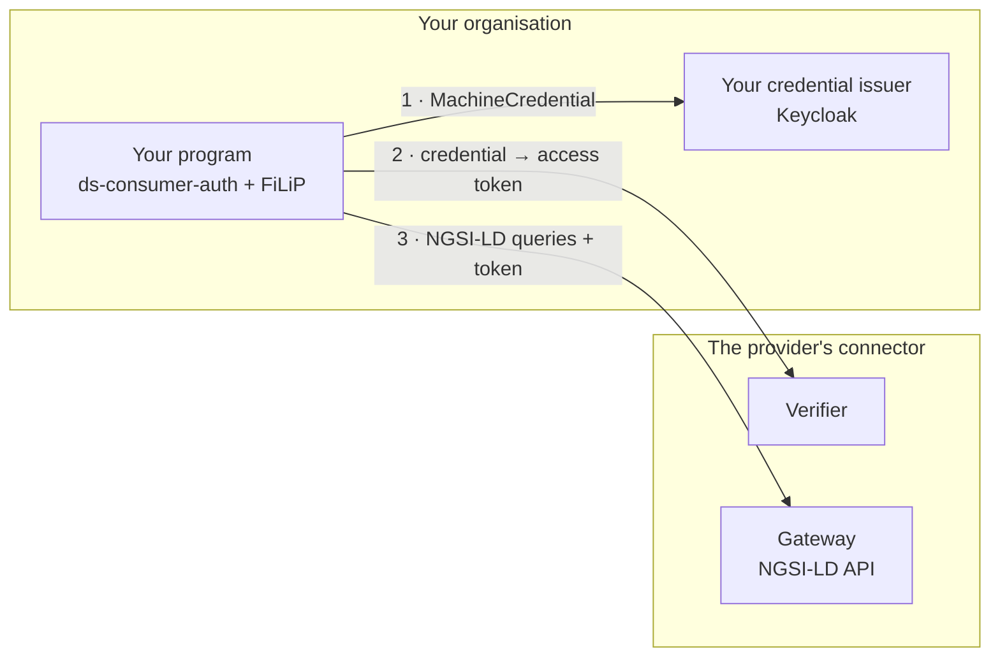

# Use data from your code

**What you will get**: a Python program that reads the data of another organisation through its connector, with a `MachineCredential` of your organisation. It works the same for any data offer in the marketplace.



## What you need

- Your organisation [registered in the data space](join.md), with a credential issuer: the realm created by the onboarding portal or [your own connector](deploy_connector.md).
- Its legal representative (LEAR) able to log in to the [marketplace](https://marketplace.citcom-vrain-dataspace.eu).
- Access to the admin console of your Keycloak, to create a machine user.
- Python 3.10 or later.

## Steps

### 1. Choose an offer and note its access details

Open the [marketplace](https://marketplace.citcom-vrain-dataspace.eu), find the dataset and open its offer. The description of every data offer gives what your program needs:

| Detail | Where | Example |
|---|---|---|
| **API address** of the provider | *API access* | `https://apisix-<provider>.citcom-vrain-dataspace.eu` and a path such as `/ngsi-ld` |
| **Entity type** | *API access*, *Available data* | `WasteContainer` |
| **Verifier** of the provider and **scope** | *Access* | `https://verifier-<provider>.citcom-vrain-dataspace.eu/services/machine-id`, scope `operator1` |
| **Role** your credential must carry | The offer's credential policy | `clearence1` |

!!! example "To try it: the Valencia offers"

    The [Ajuntament de València](../valencia/index.md#data-in-the-data-space) offers four datasets that are always on. They are a good first test; the rest of this guide uses its *Waste containers* offer as the example. Replace the values with those of your offer.

### 2. Create a machine user in your Keycloak

Your program logs in as a user of its own, never as a person. In the admin console of your Keycloak:

1. **Users → Add user**: a name such as `reader1`, with an email. Then **Credentials → Set password**, not temporary.
2. **Role mapping → Assign role → Filter by clients**: choose the role the offer asks for in the client `roles-dataspace` (`clearence1`). Give it **only** the roles of the offers this program uses: the provider's verifier rejects a credential that carries a role the purchase does not allow.
3. Bind the `MachineCredential` to the user. See [Create the users](deploy_connector.md#5-create-the-users): having the role is not enough.

### 3. Buy the offer

The LEAR logs in to the marketplace, opens the offer and buys it. When the order is **completed**, the provider's connector trusts the `MachineCredential` of your organisation and loads the access policy of the offer. This takes a few seconds.

### 4. Install the libraries

```bash
python3 -m venv .venv && source .venv/bin/activate
pip install "ds-consumer-auth @ git+https://github.com/CitComAI-Hub/ds-consumer-auth@v0.1.0" filip
```

[ds-consumer-auth](../toolbox/ds_consumer_auth.md) gets the credential and the access token, and renews them. [FiLiP](../toolbox/ngsi_ld.md) is the NGSI-LD client.

### 5. Configure

```bash title=".env"
# Your organisation: who you are
export DS_ISSUER_URL="https://<your Keycloak host>/realms/<your realm>"
export DS_USERNAME="reader1"
export DS_PASSWORD="<its password>"
# The provider: who you ask (from step 1)
export DS_VERIFIER_URL="https://verifier-townhall-vlc.citcom-vrain-dataspace.eu/services/machine-id"
export DS_SCOPE="operator1"
```

```bash
source .env
```

Keep the password out of your repository.

### 6. Check the token

```bash
ds-token > /dev/null && echo "token OK"
```

If it prints `token OK`, your credential is accepted by the provider. If not, see [If something fails](#if-something-fails) before going on.

### 7. Read the data

```python title="read_data.py"
from filip.clients.ngsi_ld.cb import ContextBrokerLDClient
from filip.models.base import FiwareLDHeader
from ds_consumer_auth import data_space_session

cb = ContextBrokerLDClient(
    # API address + path, without /ngsi-ld (FiLiP adds it)
    url="https://apisix-townhall-vlc.citcom-vrain-dataspace.eu/lepus",
    session=data_space_session(),  # adds the data space token to every request
    fiware_header=FiwareLDHeader(),
    create_tenant=False,
)
for entity in cb.get_entity_list(entity_type="WasteContainer", limit=10):
    print(entity.id, entity.model_dump().get("fillingLevel"))
```

```bash
python read_data.py
```

It prints ten entities. To read more, page with `offset`, or filter with `q`, for example `q="fillingLevel>0.8"`.

## Check that it works

The same query with `curl`, using the token of the library:

```bash
curl -s -H "Authorization: Bearer $(ds-token)" -H "Accept: application/ld+json" \
  "https://apisix-townhall-vlc.citcom-vrain-dataspace.eu/lepus/ngsi-ld/v1/entities?type=WasteContainer&limit=1"
```

It returns one entity in JSON-LD.

## Several offers

- **Same provider, same role**: one machine user and one session are enough. Each purchase adds the access policy of its offer.
- **Offers that ask for different roles**: use one machine user per role. A credential is accepted only if *all* its roles are allowed by one purchase, so a user with two roles fails both.
- **Several providers**: one session per provider, each with the verifier of its provider:

```python
from ds_consumer_auth import ConsumerConfig, data_space_session

def session_for(provider_verifier: str):
    return data_space_session(ConsumerConfig(
        issuer_url="https://<your Keycloak host>/realms/<your realm>",
        username="reader1",
        password="<its password>",
        verifier_url=provider_verifier,
        scope="operator1",
    ))
```

## If something fails

| Symptom | Cause | Fix |
|---|---|---|
| `login: request failed (HTTP 401)` | Wrong user or password, or `DS_ISSUER_URL` points to another realm | Check them in your Keycloak |
| The credential request fails, or the account console says *You have no verifiable credentials yet* | The `MachineCredential` is not bound to the machine user | Step 2.3 |
| `vp_token: the verifier rejected the credential (HTTP 400: {})` | The provider does not trust your organisation for `MachineCredential`: the offer is not bought, or the order is not completed. Or the machine user has a role the offer does not allow | Check the order in the marketplace; leave only the offer's role on the machine user |
| The same `400`, and the order is completed | Your organisation is not in the trust anchor, or the provider cannot resolve your DID | Check that your registration is approved and that your `did.json` is reachable from the internet |
| `401` from the provider's gateway | A token from another verifier, or the wrong scope | Check `DS_VERIFIER_URL` and `DS_SCOPE` |
| `403` from the provider's gateway | The token is valid, but no purchased policy allows this request | Check that the path and the entity type are those of the offer you bought |
| The query returns `[]` | The access is fine, but there is no entity of that type in that path | Check the entity type and the path in the offer |
