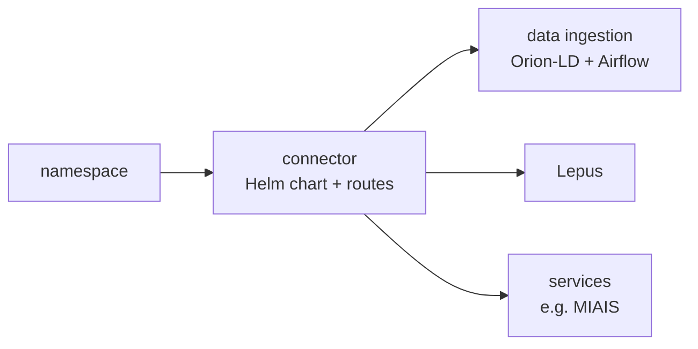

# Deploy your own connector

**What you will get**: an overview of what a FIWARE connector is made of and how CitCom deploys one, so you can plan your own. This is not a step-by-step installation: a production connector depends on your infrastructure.

## What you need

- A **Kubernetes** cluster. CitCom uses [k3s](https://k3s.io/) on its own servers.
- A **domain** whose DNS you control, and TLS certificates for each public host name (CitCom uses [cert-manager](https://cert-manager.io/) with Let's Encrypt).
- [Helm](https://helm.sh/) and, to keep the deployment reproducible, [Terraform](https://www.terraform.io/).
- Basic knowledge of Kubernetes. If you are new to it, start with the [local options](#learn-locally-first) below.

## What a connector is made of

The [FIWARE Data Space Connector](https://github.com/FIWARE/data-space-connector) is a Helm chart; CitCom runs version 10. Each participant has its own namespace with:

| Component | Public host | Role |
|---|---|---|
| Keycloak | `keycloak-<participant>.<domain>` | Issues the credentials of your people and programs (OID4VCI) |
| Verifier | `verifier-<participant>.<domain>` | Turns the credentials of others into access tokens |
| APISIX + OPA | `apisix-<participant>.<domain>` | Gateway in front of your data and services, with the policy engine |
| ODRL-PAP, Trusted Issuers List | — | Your access policies and the organisations you trust |
| contract-management | `contract-management-<participant>.<domain>` | Applies the purchases of your offers coming from the marketplace |
| Scorpio + PostgreSQL | — | An NGSI-LD broker and the databases of the components |
| did-helper | `<participant>.<domain>` | Publishes your `did:web` document |

Plus, if you need them: your own NGSI-LD broker and ingestion (CitCom uses Orion-LD and Airflow), [Lepus](../toolbox/lepus.md) for an NGSI-v2 platform, and your web services.

See [Inside a connector](../data_spaces/fiware.md#inside-a-connector) for how they work together.

## How CitCom deploys it

CitCom keeps each participant as a set of Terraform layers, applied in order. Each layer has its own state, so a change in one does not touch the others:

A few lessons from running it:

- **Extra routes**: the chart's default route `/ngsi-ld/*` goes to the built-in broker. Routes for other brokers (such as `/lepus/ngsi-ld/*`) or for web services are added to APISIX with the same token check and OPA policy.
- **Roles**: create the data space roles (for example `clearence1` and one per service) in the client `roles-dataspace` of your Keycloak, and give each user or machine only the roles it needs.
- **Credentials**: a user only receives the credentials that are bound to it, not just the ones its roles allow.
- **Test users**: the example realm of the chart includes test users with known passwords. Remove them or change their passwords before going to production.
- **Secrets**: keep admin passwords and client secrets out of the repository, in a separate variables file or a secret store.
- **Images**: deploy your own images with a new version tag each time; a node does not pull again a tag it already has.

## Register it in the data space

Once the connector is up and its `did:web` document is published:

1. [Join the data space](join.md) with that DID.
2. Set the contract management address in the organisation's marketplace profile.
3. Publish your first [dataset](publish_dataset.md) or [service](publish_service.md).

## Learn locally first

To understand the pieces before deploying for real:

- The CitCom [Minimum Viable Data Space](https://github.com/CitComAI-Hub/Minimum_Viable_DataSpace_Infrastructure) deploys a minimal FIWARE data space (trust anchor, provider and consumer) in a local Kind cluster.
- FIWARE's [local deployment](https://github.com/FIWARE/data-space-connector/blob/main/doc/deployment-integration/local-deployment/LOCAL.MD) is more complete and needs more resources.

## Videos

- [FIWARE vision on data spaces](https://www.youtube.com/watch?v=phCPgxzT8t0)
- [Data spaces: a practical introduction into roles and components](https://www.youtube.com/watch?v=hm5qMlhpK0g)
- [Decentralised IAM based on verifiable credentials and ODRL](https://www.youtube.com/watch?v=zz7MHd3imzs)
- [Contract negotiation in data spaces](https://www.youtube.com/watch?v=kkvNQfkVJkg)
