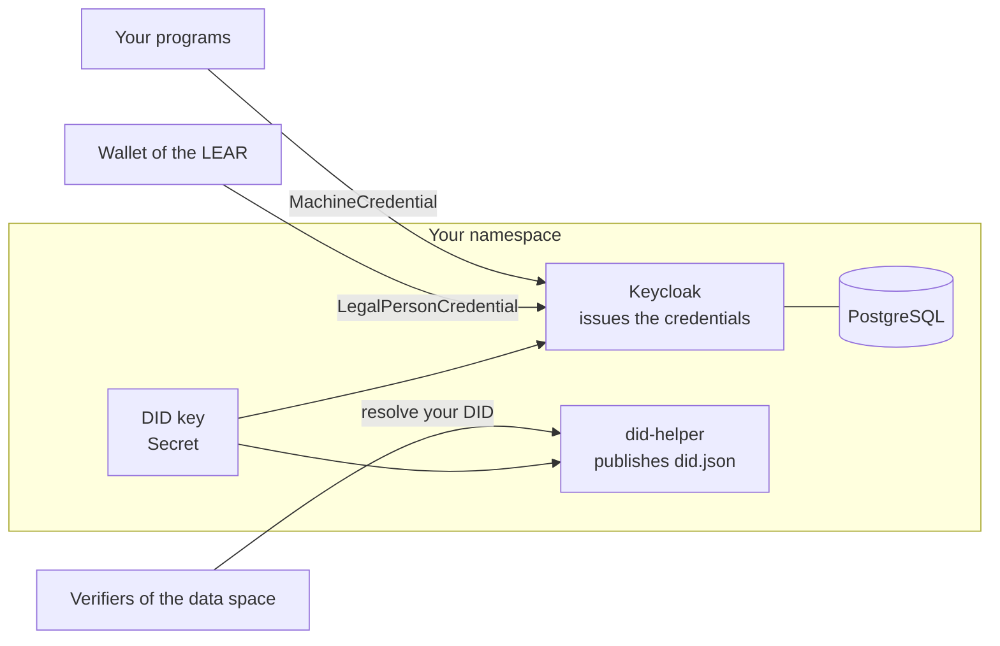

# Deploy your own connector

**What you will get**: a **consumer connector** for your organisation in your own Kubernetes cluster. It gives your organisation a DID and issues its credentials: the `LegalPersonCredential` of its legal representative, to buy in the marketplace, and the `MachineCredential` of its programs, to read data. That is all a consumer needs; the [provider components](#become-a-provider) can be added later.

!!! warning "First version of this guide"

    The configuration comes from the connectors running in the CitCom data space, but this guide has not yet been followed from start to finish on a new cluster. Report anything that does not work in the [repository](https://github.com/CitComAI-Hub/CitComAI-Hub.github.io/issues).



The same key signs your credentials (in Keycloak) and is published in your DID document (by did-helper). That is how the verifiers of other participants check that a credential is yours.

## What you need

- A **Kubernetes** cluster reachable from the internet, with an ingress controller ([ingress-nginx](https://kubernetes.github.io/ingress-nginx/)).
- [cert-manager](https://cert-manager.io/) with two `ClusterIssuer`s: one for Let's Encrypt (here `letsencrypt`) and one self-signed (here `selfsigned-issuer`).
- Two public host names in a domain you control, pointing to your ingress. This guide uses:
    - `did.example.org`: your DID will be `did:web:did.example.org`;
    - `keycloak.example.org`: your credential issuer.
- `kubectl` and [Helm](https://helm.sh/) 3.

Replace `example.org` with your domain everywhere.

## Steps

### 1. Create the namespace and the secrets

```bash
kubectl create namespace connector

# Admin password of Keycloak, and the password of the keystore that holds the DID key
kubectl -n connector create secret generic issuance-secret \
  --from-literal=keycloak-admin="$(openssl rand -base64 24)" \
  --from-literal=store-pass="$(openssl rand -hex 16)"

# Database user of Keycloak
kubectl -n connector create secret generic database-credentials \
  --from-literal=username=keycloak \
  --from-literal=password="$(openssl rand -hex 16)"
```

### 2. Create the DID key

An EC P-256 key, issued by the self-signed issuer. Its certificate is only a container for the key: it is not used for TLS.

```yaml title="did-key.yaml"
apiVersion: cert-manager.io/v1
kind: Certificate
metadata:
  name: did-key
  namespace: connector
spec:
  commonName: did.example.org
  dnsNames: [did.example.org]
  secretName: did-key
  privateKey:
    algorithm: ECDSA
    size: 256
  usages: [digital signature, key encipherment]
  issuerRef:
    group: cert-manager.io
    kind: ClusterIssuer
    name: selfsigned-issuer
```

```bash
kubectl apply -f did-key.yaml
kubectl -n connector wait --for=condition=Ready certificate/did-key --timeout=120s
```

### 3. Publish your DID with did-helper

```yaml title="did-helper.yaml"
image:
  repository: quay.io/seamware/did-helper
  tag: 0.4.4
config:
  server:
    hostUrl: https://did.example.org
    certPath: /certs/tls.crt
  generateKey:
    enabled: false
volumes:
  - name: certs
    secret:
      secretName: did-key
      items: [{ key: tls.crt, path: tls.crt }]
volumeMounts:
  - { name: certs, mountPath: /certs, readOnly: true }
ingress:
  enabled: true
  className: nginx
  annotations:
    cert-manager.io/cluster-issuer: letsencrypt
  hosts:
    - host: did.example.org
      paths: [{ path: /, pathType: Prefix }]
  tls:
    - secretName: did-example-org-tls
      hosts: [did.example.org]
```

```bash
helm repo add fiware https://fiware.github.io/helm-charts/
helm install did fiware/did-helper -n connector -f did-helper.yaml
```

Check it, from a machine outside your network:

```bash
curl -s https://did.example.org/.well-known/did.json
```

It returns a DID document whose `id` is `did:web:did.example.org`.

### 4. Install PostgreSQL and Keycloak

**PostgreSQL**, with a database for Keycloak:

```yaml title="postgres.yaml"
fullnameOverride: postgres
auth:
  username: keycloak
  database: keycloak
  existingSecret: database-credentials
  secretKeys:
    adminPasswordKey: password
```

```bash
helm install postgres oci://registry-1.docker.io/cloudpirates/postgres --version 0.20.3 \
  -n connector -f postgres.yaml
```

**The realm.** Download the [consumer realm](../assets/connector/consumer-realm.json) and replace the two host names:

```bash
curl -sLO https://citcomai-hub.github.io/assets/connector/consumer-realm.json
sed -i 's/DID_HOST/did.example.org/g; s/KEYCLOAK_HOST/keycloak.example.org/g' consumer-realm.json
kubectl -n connector create configmap realm --from-file=provider-realm.json=consumer-realm.json
```

The realm, called `provider`, defines everything the data space expects from an issuer:

| Item | Value | Used by |
|---|---|---|
| Credential `LegalPersonCredential` | SD-JWT (`dc+sd-jwt`), ES256, bound to the holder's key; claims `firstName`, `lastName`, `email`, and `roles` from the client `marketplace` | The marketplace login |
| Credential `MachineCredential` | Same format; claims `email` and `roles` from the client `roles-dataspace` | The verifiers of the providers |
| Credential `ServiceCredential` | Same format; claims from `roles-dataspace` | Web services bought by your organisation |
| Client `marketplace` | Role `REPRESENTATIVE` | The LEAR |
| Client `roles-dataspace` | Roles `clearence1` to `clearence4`; add the roles your offers ask for | Your programs and people |
| Client `account-console` | Direct access grants and OID4VCI enabled | [ds-consumer-auth](../toolbox/ds_consumer_auth.md) and the wallets |
| Signing key | The DID key, from the keystore `/did-material/cert.pfx`, with `kid` = your DID | Every credential |

The `${…}` values left in the file (`${STORE_PASS}`, `${role_…}`) are read by Keycloak itself: leave them as they are.

**Keycloak.** It must be the SEAMWARE image 26.6.2: it includes the credential offer endpoint that the wallets and ds-consumer-auth use. An init container packs the DID key into the keystore that the realm reads.

```yaml title="keycloak.yaml"
image:
  registry: quay.io
  repository: seamware/keycloak
  tag: "26.6.2"
keycloak:
  adminUser: keycloak-admin
  existingSecret: issuance-secret
  secretKeys:
    adminPasswordKey: keycloak-admin
  hostname: https://keycloak.example.org
  httpEnabled: true
  httpsEnabled: false   # TLS ends at the ingress
  proxyHeaders: xforwarded
  production: true
# Keep the providers and themes bundled in the SEAMWARE image
preserveProviders: true
preserveThemes: true
extraEnvVars:
  - name: STORE_PASS
    valueFrom: { secretKeyRef: { name: issuance-secret, key: store-pass } }
extraVolumes:
  - { name: did-material, emptyDir: {} }
  - { name: realms, configMap: { name: realm } }
  - { name: did-key, secret: { secretName: did-key } }
extraVolumeMounts:
  - { name: did-material, mountPath: /did-material }
  - { name: realms, mountPath: /opt/keycloak/data/import }
extraInitContainers:
  - name: create-did-keystore
    image: ubuntu:22.04
    command: [/bin/bash, -ec]
    args:
      - |
        apt-get -y update && apt-get -y install --no-install-recommends openssl ca-certificates
        openssl pkcs12 -export -out /did-material/cert.pfx \
          -inkey /did-key/tls.key -in /did-key/tls.crt \
          -certfile /etc/ssl/certs/ISRG_Root_X1.pem \
          -name didPrivateKey -passout env:STORE_PASS
        chmod 666 /did-material/cert.pfx
    env:
      - name: STORE_PASS
        valueFrom: { secretKeyRef: { name: issuance-secret, key: store-pass } }
    volumeMounts:
      - { name: did-material, mountPath: /did-material }
      - { name: did-key, mountPath: /did-key }
realm:
  import: true
features:
  enabled: [oid4vc-vci, oid4vc-vci-preauth-code, oid4vc-vci-rest-credential-offer]
postgres:
  enabled: false
database:
  type: postgres
  host: postgres
  port: "5432"
  name: keycloak
  existingSecret: database-credentials
  secretKeys: { usernameKey: username, passwordKey: password }
ingress:
  enabled: true
  className: nginx
  annotations:
    cert-manager.io/cluster-issuer: letsencrypt
  hosts:
    - host: keycloak.example.org
      paths: [{ path: /, pathType: Prefix }]
  tls:
    - secretName: keycloak-example-org-tls
      hosts: [keycloak.example.org]
resources:
  requests: { cpu: 500m, memory: 640Mi }
  limits: { cpu: "1", memory: 2Gi }
```

```bash
helm install keycloak oci://registry-1.docker.io/cloudpirates/keycloak --version 0.21.4 \
  -n connector -f keycloak.yaml
kubectl -n connector rollout status statefulset/keycloak --timeout=10m
```

Check that it issues credentials:

```bash
curl -s https://keycloak.example.org/realms/provider/.well-known/openid-credential-issuer \
  | python3 -c 'import json,sys; print(sorted(json.load(sys.stdin)["credential_configurations_supported"]))'
```

It prints `['LegalPersonCredential', 'MachineCredential', 'ServiceCredential']`.

!!! note "The realm is imported only once"

    Keycloak imports the realm file only if the realm does not exist yet. Later changes to the file do not reach a running Keycloak: make them in the admin console, or with its admin API.

### 5. Create the users

Open the admin console at `https://keycloak.example.org/admin`, user `keycloak-admin`, with the password of step 1:

```bash
kubectl -n connector get secret issuance-secret -o jsonpath='{.data.keycloak-admin}' | base64 -d; echo
```

In the realm **provider**, create one user per role, never one user for everything:

| User | Roles (client → role) | Credential to bind |
|---|---|---|
| The LEAR, with email, first and last name | `marketplace` → `REPRESENTATIVE` | `LegalPersonCredential` |
| A machine user for each program, such as `reader1` | `roles-dataspace` → the role of the offers it reads (`clearence1`) | `MachineCredential` |

For each one: **Users → Add user**, then **Credentials → Set password** (not temporary), then **Role mapping → Assign role**.

Having the role is not enough: Keycloak only issues the credentials that are **bound** to the user. Bind them with the admin API:

```bash
KC=https://keycloak.example.org
ADMIN_PASSWORD=$(kubectl -n connector get secret issuance-secret -o jsonpath='{.data.keycloak-admin}' | base64 -d)
TOKEN=$(curl -s "$KC/realms/master/protocol/openid-connect/token" \
  -d grant_type=password -d client_id=admin-cli -d username=keycloak-admin \
  --data-urlencode "password=$ADMIN_PASSWORD" | python3 -c 'import json,sys; print(json.load(sys.stdin)["access_token"])')

bind() {  # bind <username> <credential>
  USER_ID=$(curl -s -H "Authorization: Bearer $TOKEN" "$KC/admin/realms/provider/users?username=$1&exact=true" \
    | python3 -c 'import json,sys; print(json.load(sys.stdin)[0]["id"])')
  curl -s -o /dev/null -w "$1 $2: %{http_code}\n" -X POST -H "Authorization: Bearer $TOKEN" \
    -H "Content-Type: application/json" -d "{\"credentialScopeName\": \"$2\"}" \
    "$KC/admin/realms/provider/users/$USER_ID/vc/credentials"
}
bind lear LegalPersonCredential
bind reader1 MachineCredential
```

Each call prints a `2xx` code. Log in to the account console (`$KC/realms/provider/account`) as each user: **Verifiable Credentials** lists the bound credential.

### 6. Register in the data space

[Join the data space](join.md) with option B and your DID, `did:web:did.example.org`. When the registration is approved, your credentials are trusted.

## Check that it works

With the machine user, the [ds-consumer-auth](../toolbox/ds_consumer_auth.md) library can get a credential from your Keycloak:

```bash
pip install "ds-consumer-auth @ git+https://github.com/CitComAI-Hub/ds-consumer-auth@v0.1.0"
python3 - <<'EOF'
from ds_consumer_auth import ConsumerConfig, CredentialIssuer, HolderKey
issuer = CredentialIssuer(ConsumerConfig(
    issuer_url="https://keycloak.example.org/realms/provider",
    username="reader1", password="<its password>"))
credential = issuer.issue(HolderKey.generate())
print(credential.claims["iss"], credential.claims["vct"])
EOF
```

It prints `did:web:did.example.org MachineCredential`. To read data, buy an offer and follow [Use data from your code](consume_data.md).

## Before going to production

- **Back up** the Secret `did-key`: if the key is lost, your organisation needs a new DID and a new registration.
- Keep the Keycloak admin password and the user passwords in a secret store, not in a repository.
- Give each user and program only the roles it needs. A verifier rejects a credential that carries a role the purchase does not allow.

## If something fails

| Symptom | Cause | Fix |
|---|---|---|
| `did.json` returns `404` or a TLS error | The ingress or the Let's Encrypt certificate of `did.example.org` is not ready | `kubectl -n connector get ingress,certificate` |
| The credential endpoints fail, or Keycloak logs errors about missing OID4VC providers | The chart hid the providers of the image | Keep `preserveProviders: true` |
| Keycloak does not start: keystore error | `STORE_PASS` differs between the init container and Keycloak, or the key Secret is missing | Both read `issuance-secret`; check that `did-key` exists |
| The issuer metadata does not list the credentials | Wrong image, or the OID4VCI features are not enabled | Use `quay.io/seamware/keycloak:26.6.2` and the three `features` of step 4 |
| The metadata shows `http://` addresses | Keycloak does not see the original scheme | Keep `hostname: https://…` and `proxyHeaders: xforwarded` |
| *You have no verifiable credentials yet* in the account console | The credential is not bound to the user | The `bind` call of step 5 |
| The verifiers of other participants reject your credentials | Your registration is not approved, or the `kid` of the key does not match your DID | Check the status in the onboarding portal; check that `DID_HOST` was replaced in the realm |

## Become a provider

To publish data or services, the connector also needs the provider components of the [FIWARE Data Space Connector](https://github.com/FIWARE/data-space-connector) (CitCom runs version 10):

| Component | Role |
|---|---|
| Verifier | Turns the credentials of other organisations into access tokens |
| APISIX + OPA | Gateway in front of your data and services, with the policy engine |
| ODRL-PAP and Trusted Issuers List | Your access policies and the organisations you trust |
| contract-management | Applies the purchases of your offers coming from the marketplace |
| An NGSI-LD broker | Your data, or [Lepus](../toolbox/lepus.md) in front of an NGSI-v2 platform |

See [Inside a connector](../data_spaces/fiware.md#inside-a-connector) for how they work together, then [Publish a dataset](publish_dataset.md). Lessons from running them in CitCom:

- **Extra routes**: the chart's default route `/ngsi-ld/*` goes to its built-in broker. Routes for other brokers (such as `/lepus/ngsi-ld/*`) or web services are added to APISIX with the same token check and OPA policy.
- **contract-management** must be reachable by the marketplace; set its address in your organisation's marketplace profile.
- **Images**: deploy your own images with a new version tag each time; a node does not pull again a tag it already has.

## Learn locally first

- The CitCom [Minimum Viable Data Space](https://github.com/CitComAI-Hub/Minimum_Viable_DataSpace_Infrastructure) deploys a minimal FIWARE data space (trust anchor, provider and consumer) in a local Kind cluster.
- FIWARE's [local deployment](https://github.com/FIWARE/data-space-connector/blob/main/doc/deployment-integration/local-deployment/LOCAL.MD) is more complete and needs more resources.
