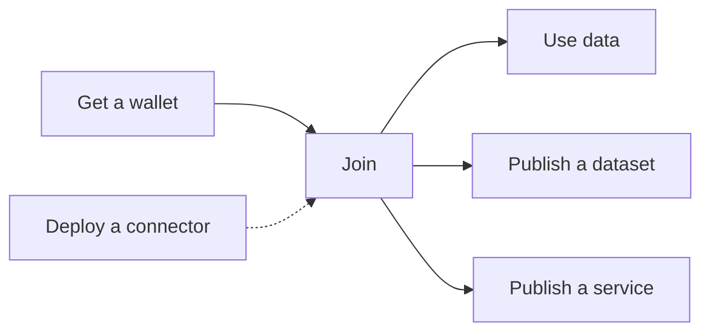

# Build

Build a service on the CitCom data space. Start with the [MIAIS](../miais/index.md), a worked example that goes from a custom integration to a data space service. Then follow the guides: each one covers one task, from start to finish, in the [FIWARE data space](../data_spaces/fiware.md). They all follow the same structure: what you will get, what you need, the steps, how to check that it works and what to do if it does not.

| Guide | For | You end up with |
|---|---|---|
| [Get a wallet and your credentials](wallet.md) | Anyone | A wallet with your credential, ready to log in |
| [Join the data space](join.md) | The legal representative (LEAR) of an organisation | Your organisation registered, with its profile in the marketplace |
| [Use data from your code](consume_data.md) | Developers of a consumer | A program that reads another organisation's data |
| [Publish a dataset](publish_dataset.md) | Data providers | An offer in the marketplace that others can buy |
| [Publish a web service](publish_service.md) | Service providers | A web app that people from other organisations open with their wallet |
| [Deploy your own connector](deploy_connector.md) | Operators | An overview of what a connector is made of and how it is deployed |

!!! tip "New to data spaces?"

    Read [Data spaces in 5 minutes](../getting_started/data_spaces.md) first. The guides use its vocabulary: participant, connector, credential, offer and policy.
