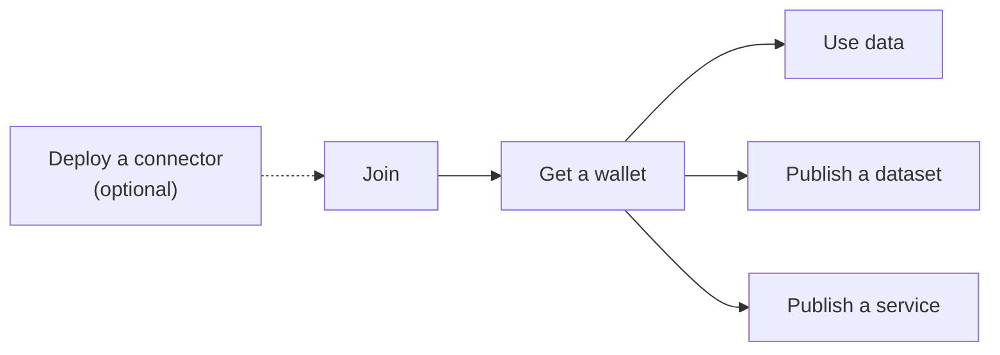

# Guides

Build on the CitCom.ai Data Space. Start with a worked example: the [MIAIS](../miais/index.md) shows an AI service that goes from a custom integration to a data space service, and [Valencia](../valencia/index.md) shows a city that offers its existing platform as a data provider. Then follow the guides: each one covers one task, from start to finish, in the [CitCom.ai Data Space](../data_spaces/index.md). They all follow the same structure: what you will get, what you need, the steps, how to check that it works and what to do if it does not.

| Guide | For | You end up with |
|---|---|---|
| [Join the data space](join.md) | The legal representative (LEAR) of an organisation | Your organisation registered and trusted, able to buy and read data |
| [Deploy your own connector](deploy_connector.md) | Operators who want their own infrastructure (optional) | A connector that issues your organisation's credentials |
| [Get a wallet and your credentials](wallet.md) | Anyone | A wallet with your credential, ready to log in |
| [Use data from your code](consume_data.md) | Developers of a consumer | A program that reads another organisation's data |
| [Publish a dataset](publish_dataset.md) | Data providers | An offer in the marketplace that others can buy |
| [Publish a web service](publish_service.md) | Service providers | A web app that people from other organisations open with their wallet |

!!! tip "To read data as soon as possible"

    Follow [Join the data space](join.md), then [Use data from your code](consume_data.md). Nothing to deploy: the onboarding portal gives your organisation everything it needs.

!!! tip "New to data spaces?"

    Read [Data spaces in 5 minutes](../getting_started/data_spaces.md) first. The guides use its vocabulary: participant, connector, credential, offer and policy.
