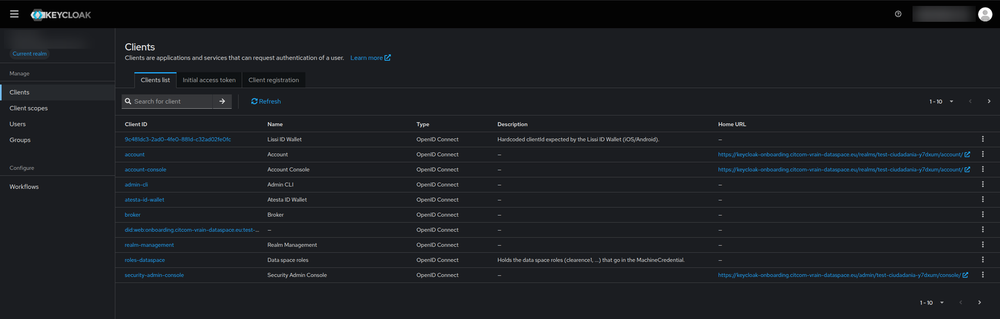
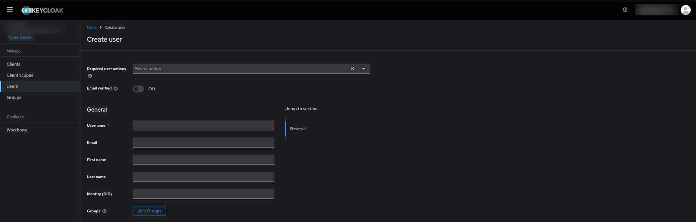
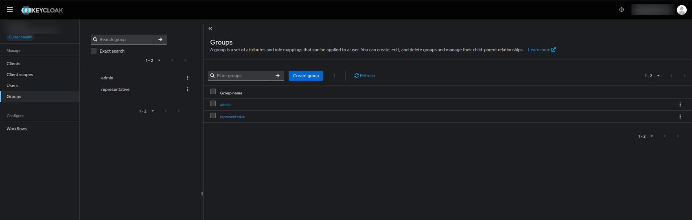
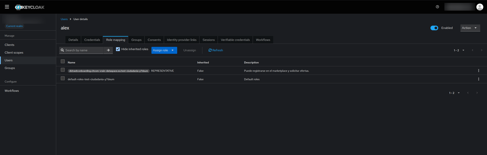
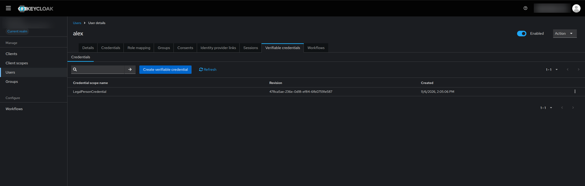
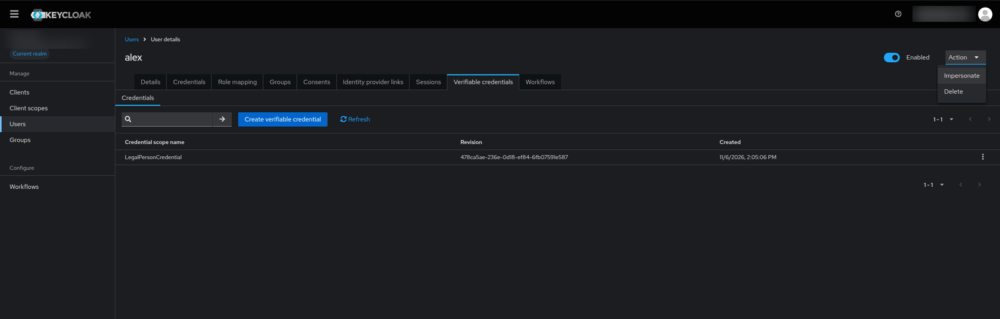
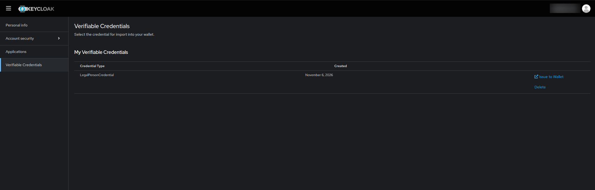
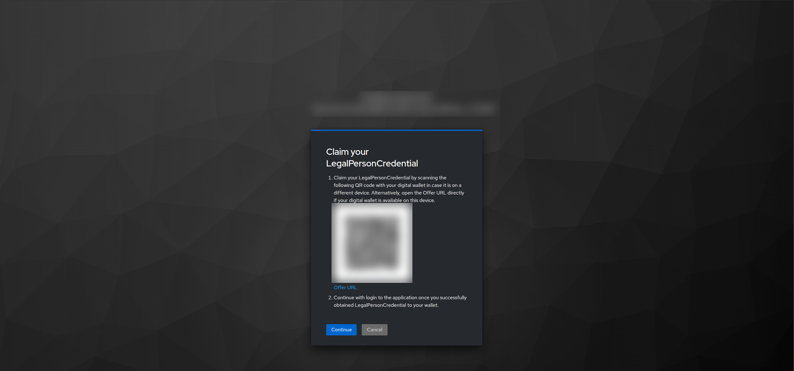

# Manage users and credentials in your Keycloak

**What you will get**: a user for each person of your organisation, with the credential it needs, ready to be loaded in a wallet.

This guide is for organisations that joined **without deploying a connector** (option A in [Join the data space](join.md)). The portal created a realm of your own in its Keycloak, and you manage it. If you run your own connector, see [Create the users](deploy_connector.md#5-create-the-users) instead.

## What you need

- The **approval email** of the onboarding portal. It arrives when the data space operator approves your registration.
- The address you gave in the form, to verify it the first time you sign in.

## Steps

### 1. Read the approval email

The email contains everything you need in one place:

- The **username** (`admin`) and a **temporary password** for the administrator of your realm.
- **Manage users & groups**: opens the admin console of your realm.
- **Step-by-step guide**: this page.
- **See more information**: the status of your registration in the onboarding portal.

The console of your realm is at `https://keycloak-onboarding.citcom-vrain-dataspace.eu/admin/<your realm>/console/`. Your realm is the last part of your DID: for `did:web:onboarding.citcom-vrain-dataspace.eu:my-city-a1b2c3`, it is `my-city-a1b2c3`.

### 2. Sign in and change the password

1. Click **Manage users & groups** and sign in with `admin` and the temporary password.
2. Keycloak asks you to **set a new password**. Choose one and keep it: the temporary one stops working.
3. Keycloak also asks you to **verify your email**. Open the message it sends to the address of the form and follow its link.

!!! warning
    The `admin` user manages the users of your organisation. Keep its password safe and do not share it. Create a separate user for each person.

The realm has the sections **Clients**, **Client scopes**, **Users** and **Groups**. You will mostly use **Users** and **Groups**.

### 3. Create a user

1. Open **Users** and click **Create new user**.
2. Fill in the **username**, **email**, **first name** and **last name**. The person receives its credential with these data.
3. Leave **Identity (DID)** empty unless the person has a DID of its own.
4. Click **Create**.
5. Open the **Credentials** tab of the user and set a password.

!!! tip
    The legal representative (LEAR) is the first user to create: it is the one that logs in to the marketplace and buys offers.

### 4. Check the group and the role

Every new user of the realm joins the group `representative`. That group gives the role `REPRESENTATIVE`, which lets the user log in to the marketplace and request offers.

1. Open **Groups**. Your realm has two: `admin`, for the people who manage the realm, and `representative`.
2. Open the user, go to **Groups** and check that it belongs to `representative`. If it does not, click **Join Group**.

3. Go to the **Role mapping** tab. You should see the role `REPRESENTATIVE` of your DID, next to the default roles of the realm.

Give the group `admin` only to the people who must create and manage users.

### 5. Check the credential of the user

Joining the group `representative` gives the user the role, but **not** the credential: Keycloak only issues a credential that is bound to the user, and only the `admin` user of the realm comes with it already. For every user you create, open the **Verifiable credentials** tab, click **Create verifiable credential** and choose `LegalPersonCredential`. Afterwards it appears in the list.

### 6. Open the account of the user: impersonate

The credential is loaded from the **account console of the user**. You can open it without knowing the password of the user:

1. In the user page, open the **Action** menu (top right).
2. Click **Impersonate**.
3. Keycloak opens the account console of that user in a new tab.

!!! note
    **Impersonate** acts as the user, so use it only to hand over the credential. The person can also sign in itself at `https://keycloak-onboarding.citcom-vrain-dataspace.eu/realms/<your realm>/account` with its own password.

### 7. Issue the credential to a wallet

1. In the account console, open **Verifiable Credentials**.
2. Click **Issue to Wallet** next to the `LegalPersonCredential`.

3. Keycloak shows **Claim your LegalPersonCredential**: a QR code and an **Offer URL**. Scan the code with the wallet, or open the Offer URL on the device that has it.
4. Accept the credential in the wallet, then press **Continue** in the browser.

Offers are short-lived. If the wallet rejects it, go back and click **Issue to Wallet** again.

### 8. Save it in your wallet

Follow [Get a wallet and your credentials](wallet.md) to install atesta-id-wallet or Lissi, accept the offer and log in to the [marketplace](https://marketplace.citcom-vrain-dataspace.eu) with it.

## Check that it works

- You can sign in to the console of your realm with the new password.
- Each person has a user with the role `REPRESENTATIVE` and a `LegalPersonCredential`.
- The wallet of the legal representative shows the credential, and the marketplace accepts its login.

## If something fails

| Symptom | Cause | Fix |
|---|---|---|
| The temporary password is rejected | You already changed it, or the email of another registration was used | Use the password you set. If you lost it, contact the operator through the portal |
| No approval email | The message went to spam, or the address in the form is wrong | Check the spam folder; otherwise contact the operator through the portal |
| The console says the page is not available for your realm | The address has a wrong realm name | Copy the link from the email, or take the realm from your DID |
| The **Verifiable credentials** tab is empty | The credential has not been created for the user yet | Click **Create verifiable credential** and choose `LegalPersonCredential` |
| *You have no verifiable credentials yet* in the account console | Same as above | Repeat step 5 for that user |
| The wallet rejects the offer, or the QR has expired | Offers are short-lived | Click **Issue to Wallet** again |
| The marketplace rejects the login | The registration is not approved yet, or the user does not have the role `REPRESENTATIVE` | Check the status in the portal and the group of the user (step 4) |
