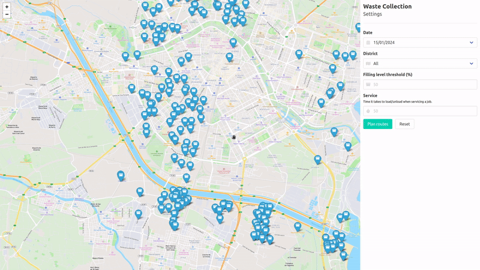
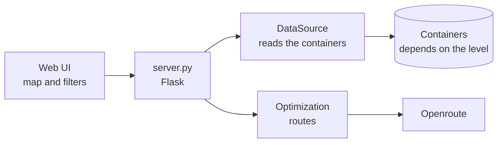

# MIAIS: build an interoperable service

The **Minimal Interoperable AI Service** (MIAIS) is a small AI service that plans waste collection routes. It is deliberately simple: its value is not the algorithm, but showing **what changes in a service when it climbs the [interoperability levels](../getting_started/interoperability.md)**, from a custom integration with one city to a service of the data space that any city can use.

[Repository :simple-github:](https://github.com/CitComAI-Hub/waste-collection-demo){ .md-button .md-button--primary } [Try it in the marketplace](https://marketplace.citcom-vrain-dataspace.eu){ .md-button }

<figure markdown>
  { loading=lazy }
</figure>

## What it does

The MIAIS reads the waste containers of a city (`WasteContainer` entities, with their location and filling level), lets the user choose the ones above a filling level, and computes the routes of the trucks with the [Openroute](https://openrouteservice.org/) optimisation service ([VROOM](https://github.com/VROOM-Project/vroom)).



Only one piece depends on the interoperability level: **where `DataSource` gets the containers from**. The rest of the service never changes.

## The three levels, one branch each

| Level | Branch | Where the containers come from | Access |
|---|---|---|---|
| 0 · Custom integration | [`valencia`](https://github.com/CitComAI-Hub/waste-collection-demo/tree/valencia) | The Valencia platform, with its own authentication and its own tenant and service path | A user of that platform |
| 1 · NGSI-LD + Smart Data Models | [`mvs-orionld`](https://github.com/CitComAI-Hub/waste-collection-demo/tree/mvs-orionld), [`mvs-scorpiold`](https://github.com/CitComAI-Hub/waste-collection-demo/tree/mvs-scorpiold) | Any NGSI-LD broker. The branches bring a local one with sample data | Open |
| 1 and 2 · Data space | [`master`](https://github.com/CitComAI-Hub/waste-collection-demo) | Any NGSI-LD broker (level 1) or the provider's connector (level 2), by configuration | None, or a `MachineCredential` |

`master` is the current version and the one to start from. The other branches are kept to show the steps.

## What changes between levels

### Level 0 → 1: from one platform to a standard

At level 0, the service speaks the dialect of one platform. Reading the containers of Valencia needs a token of the city's identity server, its tenant (`service`) and the service path where the containers are:

```python title="server.py · branch valencia (level 0)"
def get_all_WasteContainers():
    service = "tef_vlci"
    subservice = "/residuos_contenedores_vlc"

    auth = Authv2()
    token = auth.get_auth_token_subservice(service, subservice)

    context = os.environ.get("WASTECONTAINERS_CONTEXT")
    containers = client.get_all_entities_by_type(
        "WasteContainer", context, 100, 0, service, subservice, token).json()
    return containers
```

At level 1, all of that disappears. The service asks any NGSI-LD broker for `WasteContainer` entities, described with the Smart Data Model:

```python title="server.py · branch mvs-orionld (level 1)"
def get_all_WasteContainers():
    context = os.environ.get("WASTECONTAINERS_CONTEXT")
    containers = client.get_all_entities_by_type("WasteContainer", context).json()
    return containers
```

The proof: `mvs-orionld` and `mvs-scorpiold` have **exactly the same code**. They only differ in the broker that `docker compose` starts (Orion-LD or Scorpio) and its port. Two brokers from different vendors, one service.

### Level 1 → 2: add a credential, not a new integration

At level 2 the data comes from another organisation, through its data space connector. The API is still NGSI-LD, so the query is the same. The only addition is a **token of the data space** on every request, which [ds-consumer-auth](../toolbox/ds_consumer_auth.md) provides as a ready-made HTTP session. [FiLiP](../toolbox/ngsi_ld.md) is the NGSI-LD client:

```python title="services/DataSource.py · branch master (level 1 and 2)" hl_lines="6-9"
class DataSource:
    def __init__(self):
        self.url = os.environ.get("NGSI_LD_URL", "http://localhost:1026")

        session = None
        if os.environ.get("DS_ISSUER_URL"):  # level 2
            from ds_consumer_auth import data_space_session

            session = data_space_session()

        self.client = ContextBrokerLDClient(url=self.url, session=session, ...)

    def waste_containers(self):
        return self.client.get_entity_list(entity_type="WasteContainer", limit=100)
```

Whether the service runs at level 1 or level 2 is a matter of configuration:

=== "Level 1: a broker"

    ```bash
    NGSI_LD_URL="http://localhost:1026"
    ```

=== "Level 2: the CitCom data space"

    ```bash
    NGSI_LD_URL="https://apisix-townhall-vlc.citcom-vrain-dataspace.eu/lepus"
    # credential of the consumer (VRAIN), issued by its own Keycloak
    DS_ISSUER_URL="https://keycloak-vrain.citcom-vrain-dataspace.eu/realms/provider"
    DS_USERNAME="<machine user of your organisation>"
    DS_PASSWORD="<its password>"
    # verifier of the provider (Ajuntament de València)
    DS_VERIFIER_URL="https://verifier-townhall-vlc.citcom-vrain-dataspace.eu/services/machine-id"
    DS_SCOPE="operator1"
    ```

The real work of level 2 is outside the code: the consumer's organisation must have **bought the offer** in the marketplace. Until then, the provider's verifier rejects the credential. See [the purchase flow](../data_spaces/fiware.md#purchase-an-offer).

## Run it

=== "Level 1, on your machine"

    You need Docker, Python 3.12 and a free [Openroute API key](https://openrouteservice.org/).

    ```bash
    git clone https://github.com/CitComAI-Hub/waste-collection-demo.git
    cd waste-collection-demo
    docker compose up -d          # Orion-LD on http://localhost:1026, empty
    python3 -m venv venv && source venv/bin/activate
    pip install -r requirements.txt
    cp .env.example .env          # set OPENROUTESERVICE_API_KEY
    set -a && source .env && set +a
    flask --app server run        # http://127.0.0.1:5000
    ```

    The broker starts empty. Create some `WasteContainer` entities with a `location` and a `fillingLevel` first; the branch `mvs-orionld` has a script with sample data (`upsert_fake_data.py`).

=== "Level 2, against the data space"

    1. Your organisation [joins the data space](../guides/join.md) and has a machine user in its Keycloak.
    2. Its LEAR buys the *Waste containers* offer of the Ajuntament de València in the [marketplace](https://marketplace.citcom-vrain-dataspace.eu).
    3. Set the level 2 variables above in `.env` and run it as in level 1, or with Docker:

        ```bash
        docker build -t waste-collection-demo .
        docker run --rm -p 5000:5000 --env-file .env waste-collection-demo
        ```

    If `/wastecontainers` answers `502` with *the verifier rejected the credential*, the purchase is missing or not completed. The guide [Use data from your code](../guides/consume_data.md) covers the errors.

## Offer it as a service

VRAIN runs the MIAIS for everyone and offers it in the marketplace as **Access to the MIAIS Waste Collection**. An organisation buys it, and its people log in with a wallet: no accounts, no passwords.

- The web is published behind VRAIN's connector gateway, which handles the wallet login and checks the access policy.
- The service asks for its own role, `waste_collection_user`, in the person's `ServiceCredential`. The buyer's organisation gives that role only to the people who use the service.
- The app runs under a path prefix (`/waste-collection/`), so it uses relative URLs.

The guide [Publish a web service](../guides/publish_service.md) explains how to do the same with your service.

## Build your own

To turn your own service into an interoperable one, follow the same steps:

- [ ] **Model your data with Smart Data Models.** Look for an existing model in [smartdatamodels.org](https://smartdatamodels.org/) before creating one.
- [ ] **Read and write through NGSI-LD**, with a client such as [FiLiP](../toolbox/ngsi_ld.md). Keep all access to the data in one class, like `DataSource`.
- [ ] **Take every endpoint from configuration**, never from the code: broker URL, tenant, entity type.
- [ ] **Test at level 1** against a local Orion-LD and a local Scorpio. If it works with both, it does not depend on a vendor.
- [ ] **Add the data space session** with [ds-consumer-auth](../toolbox/ds_consumer_auth.md), activated by configuration.
- [ ] **Package it as a Docker image** with a versioned tag, a health check and no secrets inside.
- [ ] **If it has a web UI, use relative URLs**, so it works behind a path prefix.
- [ ] **Offer it** in the marketplace: as data, with [Publish a dataset](../guides/publish_dataset.md), or as a service, with [Publish a web service](../guides/publish_service.md).
