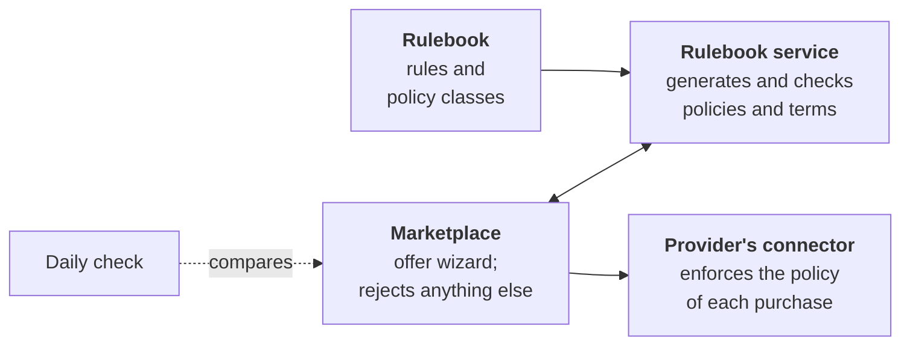

# Rulebook

The **rulebook** holds the rules that every participant of the CitCom.ai Data Space accepts when it joins: who governs the data space, how organisations join and leave, which agreements apply, what kinds of data can be offered, the terms of use of every offer, and the technical and security rules. It is written for every participant, technical or not, and follows the [DSSC Blueprint 3.0](https://blueprint.dssc.eu/).

[Read the rules](rules.md){ .md-button .md-button--primary }
[Policy classes](rules.md#7-usage-terms-policy-classes){ .md-button }

!!! note "Draft"
    The rulebook is a draft written by VRAIN-UPV. It becomes binding when the CitCom.ai consortium adopts a tagged version. Until then, the open decisions are listed at its end.

## What it contains

- **Governance**: the CitCom.ai consortium governs the data space; VRAIN-UPV operates the shared services (trust anchor, onboarding portal, marketplace) and is bound by neutrality rules.
- **Joining and leaving**: admission criteria, how access is removed when an organisation leaves or a purchase is cancelled.
- **Agreements**: joining means accepting the rulebook; buying an offer is the contract between provider and consumer.
- **Data categories**: open and shared data can be offered; confidential and personal data cannot, for now.
- **Policy classes**: every offer uses one class, which fixes its terms of use. There are three: [`open-data`](classes/open-data.md), [`dataset-access`](classes/dataset-access.md) (shared data) and [`service-access`](classes/service-access.md) (services).
- **Technical and security rules**: data is read only, follows [Smart Data Models](../toolbox/smart_data_models.md), and an offer reaches only the data it defines.

Every rule says how it is upheld: **enforced** (the software blocks what breaks it), **audited** (recorded and checked afterwards) or **contractual** (an obligation of the parties).

## How it reaches the data space

The rulebook is not only a document. The terms and conditions of every offer and its access policies are **generated** from it, so an offer cannot contradict the rules.

1. The rules and the policy classes are written in the rulebook repository; a change is proposed there and reviewed.
2. A provider publishes an offer from the marketplace with the **offer wizard**: it chooses a class and fills in a few fields. The rulebook service, next to the marketplace, generates the offer's access policies and its terms of use. Automatic tests check that every policy allows what its class allows, and nothing else.
3. The marketplace checks every offer against the rulebook again before saving it, and rejects any that the rulebook would not generate, for example one edited by hand.
4. When someone buys an offer, the provider's connector loads its policy and applies it on every request, with the request limit of its class.
5. Every day, a check reads every offer published in the marketplace and compares it with what its class generates. The badges above show the result.

## Status

| Badge | Green means |
|---|---|
| **policies** | The generator works and every policy decides as its class says. |
| **in sync with deployment** | The offers of the providers whose connectors the operator deploys are exactly what the rulebook generates. It turns red when the rulebook changes and that deployment has not taken the new version yet. |
| **marketplace offers** | Every offer published in the marketplace, from any provider, was generated from a class of the rulebook: its policies and its terms are what the class gives. |
| **version** | The rulebook version. *Draft* until the consortium adopts one. |

The *marketplace offers* check reads what is actually published, every day, whoever published it.

## What it means for you

- **Providers** publish with the offer wizard of the marketplace: they choose a class for each offer and fill in a few fields; they do not write their own terms or policies. See [Publish a dataset](../guides/publish_dataset.md) and [Publish a web service](../guides/publish_service.md).
- **Consumers** find the terms of an offer in the marketplace, with a link to its class in the rulebook. Buying an offer means accepting them.
- **Everyone** can propose a change, no technical knowledge needed: the edit button of each rulebook page opens it in GitHub's editor, where the change becomes a proposal for review. You can also open an issue in the [rulebook repository](https://github.com/CitComAI-Hub/citcom-ds-rulebook).

The rulebook pages of this site are its repository as it is: the site takes them from there every day, so a change accepted in the rulebook shows up here by the next day.
