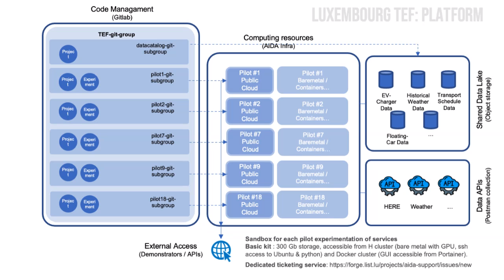

## Overview

The LIST TEF Site is located in Belval, Luxembourg and is dedicated to advancing research and development in Digital Twin technologies. This site is equipped with state-of-the-art infrastructure and is a key site in the CitCom.ai project, facilitating collaboration between cities and comunities, industrial partners (AI innovators) and research institutions.

## Services Offered

- **Digital maturity Assessment**: Guidance and support to cities and AI innovators in scoping the best-fitted AI approach, according to their needs, context and maturity. This service, which outcome is a tailored development plan for a proofof-concept, is delivered through two participatory working sessions with relevant profiles of the customer.
- **Digital Twin Scoping**: Guidance and support to cities and AI innovators in scoping the best-fitted DT approach, according to their needs, context and maturity. This service, which outcome is a tailored development plan for a proofof-concept, is delivered through two participatory working sessions with relevant profile of the customer.
- **Exploratory data Analysis**: Assessing the fit for purpose of existing data sets of the customer. The customer gets an analysis this set of data: i.e. the data fitness for their purpose and its visualization either in the form of charts or of a dashboard.
- **AI sandbox**: Supporting decision-making for cities to select a LLM for their chatbot or improve the existing.
- **Large-Scale visualization**: A customized service to allow for the exploration and analysis of large and complex datasets, supporting collaborative decision-making.
- **Proof-of-concept**: Tailored development of AI and data analytic proof-of-concept.
- **Smart cities club Luxembourg**: Smart cities club Luxembourg network of experts in Smart cities involving city representatives for reflection and common proposal around their challenges and needs.
- **Local Digital Twin Electromobility toolbox**: A true digital twin in electromobility to determine the best location for BEV charging station. This LDT can be customised on demand according to specific cities needs and challenges.
- **ViPV Simulator**: A simulator tool to quantify real potential of PV energy generation by running vehicles using weather and built-up data, that can be used by e.g. public transportation providers to support their decisionmaking towards adopting on-board photovoltaic technology.
- **Optimal EV**: A service to assess the opportunity and feasibility of solar panel on fleet.

## Infrastructure Components

<table>
  <tr>
    <th colspan="2" style="text-align: center;">Specifications</th>
  </tr>
  <tr>
    <td><strong>Data Broker<strong></td>
    <td>
      &lt;no_specified> 
      <strong>- API:</strong> &lt;no_specified> 
      <strong>- Version:</strong> &lt;no_specified>
    </td>
  </tr>
  <tr>
    <td><strong>Data Source<strong></td>
    <td>&lt;no_specified></td>
  </tr>
  <tr>
    <td><strong>IdM &amp; Auth<strong></td>
    <td>&lt;no_specified></td>
  </tr>
  <tr>
    <td><strong>Data Publication<strong></td>
    <td>&lt;no_specified></td>
  </tr>
</table>

### Architecture

## Relevant datasets of the site

- **Dataset_1**: SWIO Charging Station data

## Key Stakeholders and Partners

- **City of Differdange**: The city provides data about their current EV charging and PV generation infrastructure.
- **TICE**: Bus operator company for the South of Luxembourg country.
- **SWIO**: Charging Station provider for the city of Esch-sur-Alzette.

## Contact Information

- **Site Coordinator**: Andrés Meléndez Imaz, andres.melendez@list.lu
- **Technical Support**: Andrés Meléndez Imaz, andres.melendez@list.lu
- **General Inquiries**: Thomas Tamisier, thomas.tamisier@list.lu

---
!!! info
    This page is part of the documentation hub for the CitCom.ai project. Please ensure that the information is up-to-date and accurate.
