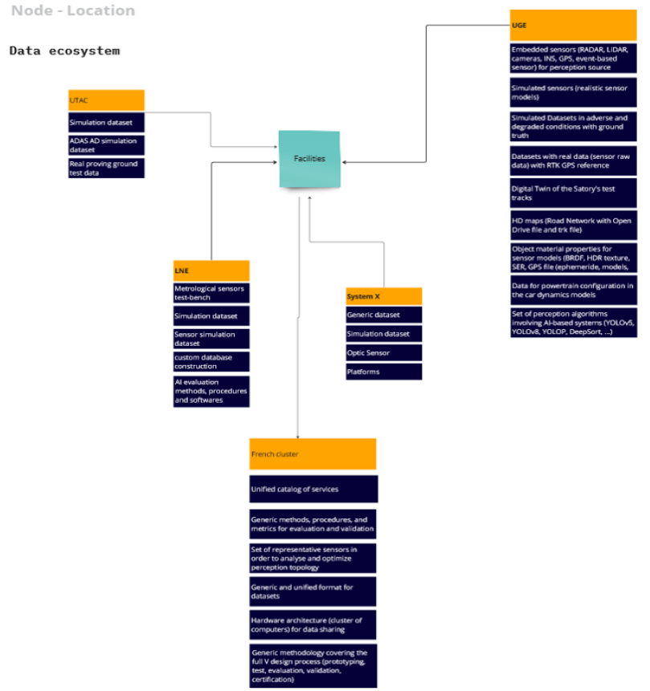

!!! note "Page to be completed"

    The partners of this site have not described it here yet. To add the description, see [Request changes](../../faq/pull_request_procedure.md).

## Overview:

The French test site is located in the Paris region at 5 dedicated sites (Trappes, Satory, Linas, Saclay and Champs-sur-Marne) and is dedicated to advancing research and development in autonomous mobility. This site is equipped with state-of-the-art infrastructure (test tracks, XiL simulation test bench...) and is a key site in the CitCom.ai project, facilitating the integration and validation of its high-risk AI devices to help them integrate into the urban environment.

## Services Offered

- **Virtual facility services**: The French node can cover all simulation needs (HIL, MIL, SIL, DIL, VIL) for the virtual design of transport systems and vehicles, evaluating multimodal Human-Computer Interactions, AI evaluation, driving simulation, intelligent sensors evaluation...
- **Physcial facility services**: We will provide test tracks for tests as close as possible to real conditions (urban or suburban traffic areas, urban road infrastructure, etc.) for example at UTAc with TEQMO or UGE at Satory. They will also be able to draw on the approval and certification expertise and the upstream research expertise to support them, depending on their stage of development. We can also provide the full range of regulatory test benches for vehicle certification  (Charging, battery, EMC, acoustic, emission, ...) or sensor characterization physical bench in addition to track tests.

The UGE will also be able to make available the Sense-City physical test facility that allows controlled weather conditions in a bench simulating a small urban area. \\

The UGE provides the real design of transport systems and vehicles, thanks to the ImPACT 3D AV which is a real automated vehicle for the prototyping, testing and evaluation of automated or communicating systems. This real prototype will make it possible to study, among other things, the impact of new technologies on the environment. ImPACT 3D AV embed a full hardware architecture with various sensor technologies to test algorithms on tracks

- **Algorithm creation & validation**: The French node will be able to carry out customised testing of all AI algorithms on software-in-the-loop benches for urban mobility applications. From the conceptualisation of the test plan, to the creation of the database (Tests can be carried out by simulation or using real data), to the choice or creation of metrics and tools, all the parameters for evaluating algorithms can be discussed.
  
In an upstream approach, IRT SystemX offers one of its reference technological platforms: DebiAI, open source platform for improving the quality of datasets and their use in learning models. This platform provides support in the specialisation of the data necessary for a use case and the representativeness of the data available or used.

We also offer cybersecurity tests.

- **Compliance & ethics assistance**: The LNE (the oldest body dedicated to AI evaluation in Europe) can also help innovators obtain certification or regulatory support for their AI algorithms (the LNE was the first in the world to provide a process certification for IA solution). The LNE can also accompany on the ethical aspects and preparation to the AI Act.
At UTAC, we can also provide the full range of regulatory test benches for vehicle certification  (Charging, battery, EMC, acoustic, emission, ...). UTAC has developed its own certification focused on autonomous vehicles.
Potential customers can also access the UTAC and LNE training catalogue on AI and autonomous vehicles

## Infrastructure Components

<table>
  <tr>
    <th colspan="2" style="text-align: center;">Specifications</th>
  </tr>
  <tr>
    <td><strong>Data Broker<strong></td>
    <td>
      &lt;no_specified> 
      <strong>- API:</strong> &lt;no_specified> 
      <strong>- Version:</strong> &lt;no_specified>
    </td>
  </tr>
  <tr>
    <td><strong>Data Source<strong></td>
    <td>&lt;no_specified></td>
  </tr>
  <tr>
    <td><strong>IdM &amp; Auth<strong></td>
    <td>&lt;no_specified></td>
  </tr>
  <tr>
    <td><strong>Data Publication<strong></td>
    <td>&lt;no_specified></td>
  </tr>
</table>

### Architecture

---
!!! info
    This page is part of the documentation hub for the CitCom.ai project. Please ensure that the information is up-to-date and accurate.
