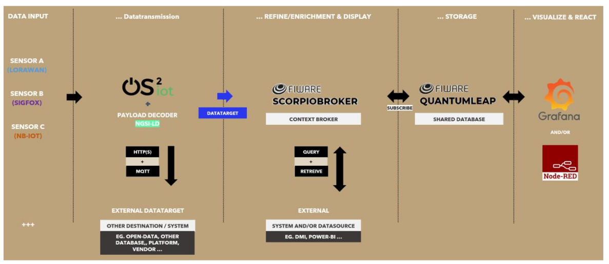
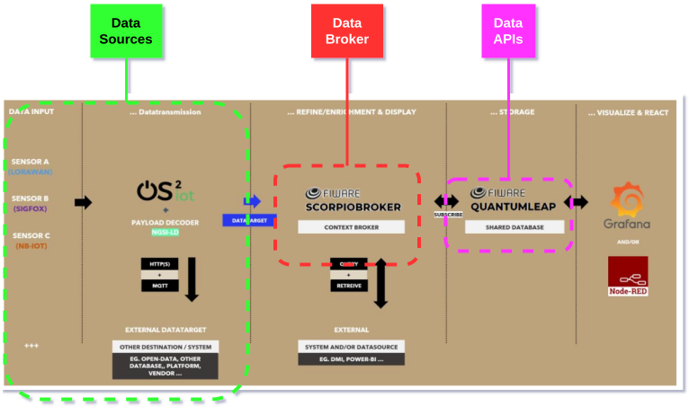

!!! note "Page to be completed"

    The partners of this site have not described it here yet. To add the description, see [Request changes](../../faq/pull_request_procedure.md).

## Infrastructure Components

<table>
  <tr>
    <th colspan="2" style="text-align: center;">Specifications</th>
  </tr>
  <tr>
    <td><strong>Data Broker<strong></td>
    <td>
      {{ config.extra.labels.data_brokers.fiware }} 
      <strong>- API:</strong> {{ config.extra.labels.api_brokers.ngsi_ld }} 
      <strong>- Version:</strong> Scorpio
    </td>
  </tr>
  <tr>
    <td><strong>Data Source<strong></td>
    <td><a href="https://www.os2.eu/os2iot">OS2IoT</a></td>
  </tr>
  <tr>
    <td><strong>IdM &amp; Auth<strong></td>
    <td>&lt;no_specified\></td>
  </tr>
  <tr>
    <td><strong>Data Publication<strong></td>
    <td>&lt;no_specified\></td>
  </tr>
</table>

### Architecture

### European Data Space for Smart Communities (DS4SSCC)

{{ config.extra.labels.ds4ssc_compliant.yes_comp.data_sources }} {{ config.extra.labels.ds4ssc_compliant.yes_comp.data_broker }} {{ config.extra.labels.ds4ssc_compliant.yes_comp.data_api }} {{ config.extra.labels.ds4ssc_compliant.no_comp.data_idm_auth }} {{ config.extra.labels.ds4ssc_compliant.no_comp.data_publication }}

## Datasets in detail

Attributes of the datasets of this site, as described by its partners.

??? info "Bikeparking stands in Aarhus City"

    | ATTRIBUTE     |   TYPE | UNITS (SI)   | DESCRIPTION/COMMENTS                  |
    |:--------------|-------:|:-------------|:--------------------------------------|
    | ID            |     | number       | numerical identicator for each stand  |
    | element       |     | txt          | the type of geographical element      |
    | elementnavn   |     | txt          | name of the stand                     |
    | bemaerkninger |     | txt          | comments                              |
    | beliggenhed   |     | txt          | adress og location                    |
    | oprettet_af   |     | internal ID  | person/system that created the item   |
    | oprettet_dato |     | date         | date of creation                      |
    | rettet_dato   |     | date         | person/system that corrected the item |
    | SP_geometry   |     | coordinates  | geograpical coordinates               |

??? info "Bike terminals in Aarhus, air and tools"

    | ATTRIBUTE     |   TYPE | UNITS (SI)   | DESCRIPTION/COMMENTS                  |
    |:--------------|-------:|:-------------|:--------------------------------------|
    | fid           |     | txt          | identicator for each route            |
    | type          |     | txt          | type of terminal                      |
    | beskrivelse   |     | txt          | description                           |
    | adress        |     | txt          | adress                                |
    | by            |     | txt          | city                                  |
    | komnr         |     | number       | municipality number                   |
    | oprettet_af   |     | internal ID  | person/system that created the item   |
    | oprettet_dato |     | date         | date of creation                      |
    | rettet_af     |     | internal ID  | person/system that corrected the item |
    | rettet_dato   |     | date         | date of correction                    |
    | MI_STYLE      |     |           |                                    |
    | MI_PRINX      |     | number       |                                    |
    | SP_geometry   |     | coordinates  | geograpical coordinates               |

??? info "Citybike locations in Aarhus"

    | ATTRIBUTE   |   TYPE | UNITS (SI)   | DESCRIPTION/COMMENTS   |
    |:------------|-------:|:-------------|:-----------------------|
    | _id         |     | number       | identicator            |
    | bid         |     | number       |                     |
    | place       |     | txt          | name og location       |
    | alttext     |     | txt          | comments               |
    | lat         |     | number       | degrees of latitude    |
    | ing         |     | number       | degrees of longitude   |
    | date        |     | date         |                     |

??? info "Fast track bikeroutes in Aarhus"

    | ATTRIBUTE      |   TYPE | UNITS (SI)   | DESCRIPTION/COMMENTS                  |
    |:---------------|-------:|:-------------|:--------------------------------------|
    | fid            |     | txt          | identicator for each route            |
    | navn_cykelrute |     | txt          | Name of route                         |
    | komnr          |     | number       | municipality number                   |
    | navn_sted      |     | txt          | name of place                         |
    | bemaerkninger  |     | txt          |                                    |
    | oprettet_af    |     | internal ID  | person/system that created the item   |
    | oprettet_dato  |     | date         | date of creation                      |
    | rettet_af      |     | internal ID  | person/system that corrected the item |
    | rettet_dato    |     | date         | date of correction                    |
    | MI_STYLE       |     |           |                                    |
    | MI_PRINX       |     | number       |                                    |
    | SP_geometry    |     | coordinates  | geograpical coordinates               |

??? info "Recreative bikeroutes in Aarhus"

    | ATTRIBUTE     |   TYPE | UNITS (SI)   | DESCRIPTION/COMMENTS                  |
    |:--------------|-------:|:-------------|:--------------------------------------|
    | fid           |     | txt          | identicator for each route            |
    | straekning    |     | number       | nummerical identicator for each route |
    | oprettet_af   |     | internal ID  | person/system that created the item   |
    | oprettet_dato |     | date         | date of creation                      |
    | rettet_dato   |     | date         | person/system that corrected the item |
    | MI_STYLE      |     |           |                                    |
    | MI_PRINX      |     |           |                                    |
    | SP_geometry   |     | coordinates  | geograpical coordinates               |

---
!!! info
    This page is part of the documentation hub for the CitCom.ai project. Please ensure that the information is up-to-date and accurate.
