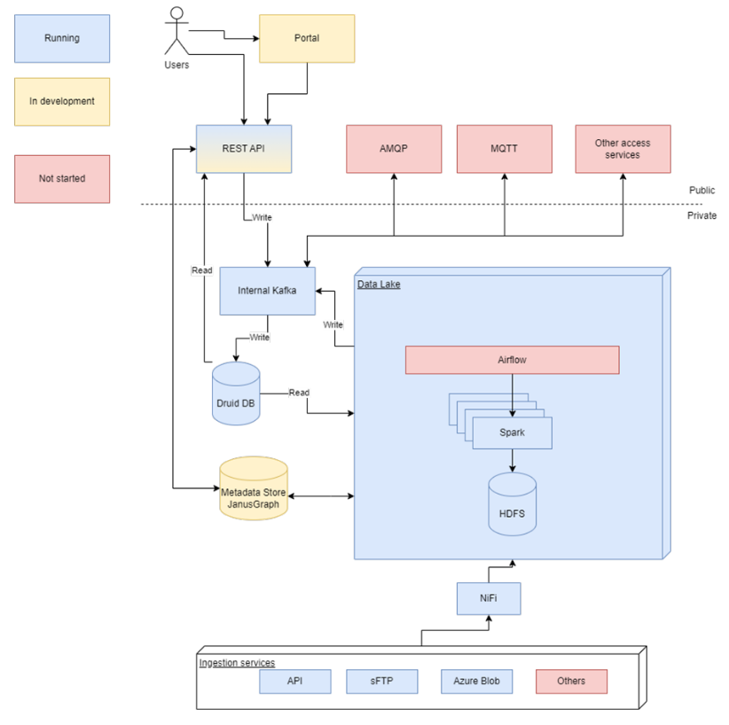
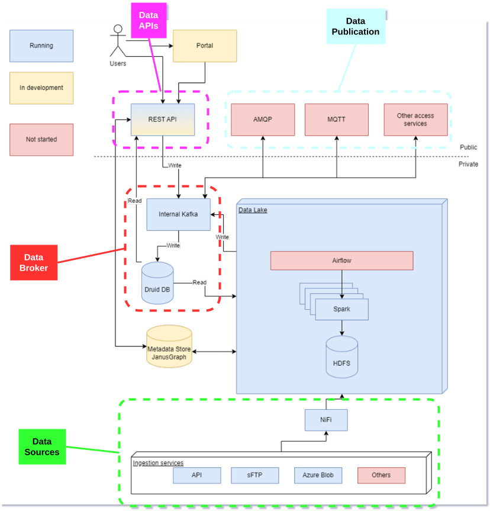

## Overview

Center Denmark is located in Fredericia, Denmark, and serves as a national hub for digitalization across the utility sector. As a TEF Site in the CitCom.ai project, Center Denmark focuses on enabling AI-driven innovation by providing access to high-quality, real-world data from electricity, water, and heating systems (including gas and PtX where relevant).

Center Denmark provides secure and structured data infrastructure that supports collaboration between utilities, AI innovators, and researchers. The site plays a central role in bridging the gap between data availability and AI application by making validated utility datasets accessible for development, testing, and scaling of smart solutions that support the green transition.

In short: Center Denmark provides access to high-quality utility data through a dedicated data portal, offering both downloadable datasets and API-based access – ready for use in AI, analytics, and research.

## Services Offered

The following services provided by Center Denmark as part of the CitCom.ai ecosystem are focused on enabling secure, structured, and value-driven access to utility data. Whether for collaboration between utilities and service providers, academic research, or early-stage experimentation, the services make it possible to work with real-world data from electricity, water, heating, gas, and PtX – all compliant with GDPR and tailored to different needs.

### Available Services and Example Datasets

Center Denmark builds customised datasets based on specific needs and can also provide predefined datasets for common use cases.  
To create tailored datasets, the platform combines a wide range of **trusted data sources** from utilities and public registers, ensuring they are structured, cleaned, and ready for use in AI training, research, forecasting, or infrastructure planning.

In addition to customised datasets, Center Denmark offers predefined datasets representing some of the most frequently requested data domains:

- **District Heating Data** – time-series consumption and production data, typically aggregated to daily values.  
- **Water Data** – metered water consumption datasets, supporting both operational and analytical applications.  
- **Electricity Data** – household or aggregated consumption data, enabling load analysis, forecasting, and optimization use cases.  

A full overview of available data sources and datasets can be explored via [**portal.centerdenmark.com**](https://portal.centerdenmark.com) or in the **Data Catalouge**. 

### Service 1: Access to Utility Data for Co-developed Digital Services  
This service supports collaboration between utility companies and service providers by granting access to structured and enriched utility data. The data is typically used for AI and analytics purposes such as forecasting, predictive maintenance, or grid planning.  
Center Denmark manages the entire data process – from collection and cleansing to enrichment and delivery – ensuring high data quality and full GDPR compliance.

📄 Documentation: *Link to documentation will be inserted later*

---

### Service 2: Build-Your-Own Utility Dataset  
This modular service enables data consumers (e.g. researchers, startups) to configure and request customized datasets based on available utility data.  
Users select a base dataset (electricity, water, heating) and can combine it with open data sources such as weather data, building information (BBR), electricity spot prices, or demographic data. The final dataset is delivered at the desired processing level (e.g. anonymised or pseudonymised), and pricing depends on the complexity and scope of the request.

📄 Documentation: *Link to documentation will be inserted later*

---

### Service 3: Open Utility Datasets  
This service provides free access to pre-approved, anonymised datasets via Center Denmark’s data portal.  
It is designed for early-stage experimentation, prototyping, education, and exploratory analysis. The datasets are ready to use and can be combined with publicly available data sources such as weather and building data, without any need for customization.

📄 Documentation: *Link to documentation will be inserted later*

## Infrastructure Components

* **Data Platforms:** Data is available from Center Denmark’s secure data platform, providing structured, GDPR-compliant datasets from utilities and public sources. Data can be accessed via RESTful APIs or by downloading datasets through the Data Portal (portal.centerdenmark.com).  
* **Local Digital Twins:** Center Denmark does not deliver a digital twin itself but provides the data infrastructure and standardized interfaces (aligned with Smart Data Models format) that enable third parties to build digital twins on top of the platform.  
* **Specific Hardware:** No physical sensors or field devices are operated directly by Center Denmark. Data is sourced from utility partners’ smart meters, SCADA/SRO systems, and IoT devices. High-performance compute resources and secure servers are used for data ingestion, processing, and structuring.  
* **IoT Platforms:** Data streams from IoT sources, such as smart meters, SCADA systems, weather stations, and building sensors, are securely integrated via partner-provided connections and standardized for use on the platform.  
* **Visualization Platforms:** Visualization is primarily based on open-source tools such as Apache Superset, offering flexible dashboards and analytics. The platform also supports integration with Power BI and other external visualization environments as needed.  

<table>
  <tr>
    <th colspan="2" style="text-align: center;">Specifications</th>
  </tr>
  <tr>
    <td><strong>Data Broker<strong></td>
    <td>
      {{ config.extra.labels.data_brokers.kafka }} 
      <strong>- API:</strong> {{ config.extra.labels.api_brokers.custom }} 
      <strong>- Version:</strong>&lt;no_specified\>
    </td>
  </tr>
  <tr>
    <td><strong>Data Source<strong></td>
    <td>Nifi</td>
  </tr>
  <tr>
    <td><strong>IdM &amp; Auth<strong></td>
    <td>&lt;no_specified\></td>
  </tr>
  <tr>
    <td><strong>Data Publication<strong></td>
    <td>MQTT, AMQP</td>
  </tr>
</table>

### Architecture

### European Data Space for Smart Communities (DS4SSCC)

{{ config.extra.labels.ds4ssc_compliant.yes_comp.data_sources }} {{ config.extra.labels.ds4ssc_compliant.yes_comp.data_broker }} {{ config.extra.labels.ds4ssc_compliant.yes_comp.data_api }} {{ config.extra.labels.ds4ssc_compliant.no_comp.data_idm_auth }} {{ config.extra.labels.ds4ssc_compliant.yes_comp.data_publication }}

## Available Data Sources

Since Center Denmark builds customised datasets based on specific needs, there are no predefined or fixed datasets available.  
Instead, the platform provides access to a wide range of **trusted data sources** from both utilities and public registers. These sources can be combined and processed to create datasets tailored to individual use cases – whether for AI training, research, forecasting, or infrastructure planning.  

The full overview of available data sources and formats can be explored at [**portal.centerdenmark.com**](https://portal.centerdenmark.com).

| **Category**           | **Examples**                                     | **Description**                                                                 |
|------------------------|--------------------------------------------------|---------------------------------------------------------------------------------|
| **Utility data**       | Electricity, water, heating, gas, PtX            | Consumption and production data from utility partners                          |
| **Grid topology**      | Electricity grids, district heating networks     | Aggregated network structures where permitted                                  |
| **Weather data**       | DMI, local weather stations                      | Temperature, wind speed/direction, solar radiation                             |
| **Building data**      | BBR (Building and Dwelling Register)             | Building type, energy label, heating system, floor area                        |
| **Price data**         | Nord Pool spot prices                            | Hourly electricity market prices                                               |
| **Geospatial references** | DAR, GIS layers                              | Geographical mapping and address-based enrichment                              |
| **Demographic data**   | Statistics Denmark                               | Population, household types, income levels (when permitted and relevant)       |

> All data is processed in compliance with GDPR and access is granted based on appropriate legal agreements with data owners.

## Contact Information

For any inquiries or collaboration opportunities related to the TEF Site at Center Denmark, please contact the relevant team member:

- **Site Coordinator**  
  **Britt Reenberg**  
  Head of PMO  
  📧 brir@centerdenmark.com

- **Technical Support**  
  **Thomas Thue Sørensen**  
  Senior Data Engineer  
  📧 thomas.soerensen@centerdenmark.com

- **General Inquiries**  
  **Andreas Okkels O. Thomsen**  
  Senior Business Developer  
  📧 andreas.thomsen@centerdenmark.com

## Datasets in detail

Attributes of the datasets of this site, as described by its partners.

??? info "District Heating Data"

    | ATTRIBUTE   | TYPE   | UNITS (SI)   | DESCRIPTION/COMMENTS   |
    |-------------|--------|--------------|------------------------|
    | id                   | INTEGER  |            | Identifier                                                                             |
    | timestamp            | DATETIME |            | Date and time are shown in UTC in ISO 8601 format. Timestamps are represented in full hours, i.e., minutes and seconds are 00. |
    | location             | STRING   |            | Address – following DAR (Danish Address Register)                                     |
    | energy               | DOUBLE   | MWh        | The heating consumption of the district heating meter water supply.                   |
    | energy_computed      | DOUBLE   | MWh        | Computed heat energy consumption based on the flow and temperature difference. Coefficients are determined for the water at 60 Degrees Celsius. |
    | flow                 | DOUBLE   | m³/h       | The flow rate of the district heating meter water supply.                             |
    | forward_temperature  | DOUBLE   | °C         | The forward temperature of the district heating meter water supply.                   |
    | return_temperature   | DOUBLE   | °C         | Return temperature     

??? info "Water Data"

    | ATTRIBUTE   | TYPE     | UNITS (SI)   | DESCRIPTION/COMMENTS                                                                                                           |
    |:------------|:---------|:-------------|:-------------------------------------------------------------------------------------------------------------------------------|
    | id          | INTEGER  |           | Identifier                                                                                                                     |
    | timestamp   | DATETIME |           | Date and time are shown in UTC in ISO 8601 format. Timestamps are represented in full hours, i.e., minutes and seconds are 00. |
    | location    | STRING   |           | Adress - following DAR (Danish Adress Register)                                                                                |
    | volumen     | DOUBLE   | M3           | Unit for Volumen                                                                                                               |
    | flow        | DOUBLE   | m³/h         | The flow rate of the water supply.                                                                                             |

??? info "Electricity Data"

    | ATTRIBUTE   | TYPE     | UNITS (SI)   | DESCRIPTION/COMMENTS                                                                                                           |
    |:------------|:---------|:-------------|:-------------------------------------------------------------------------------------------------------------------------------|
    | id          | INTEGER  |           | Identifier                                                                                                                     |
    | timestamp   | DATETIME |           | Date and time are shown in UTC in ISO 8601 format. Timestamps are represented in full hours, i.e., minutes and seconds are 00. |
    | location    | STRING   |           | Adress - following DAR (Danish Adress Register)                                                                                |
    | value       | DOUBLE   | kWh          | The actual value of the reading.                                                                                               |

---

!!! info
    This page is part of the documentation hub for the CitCom.ai project. Please ensure that the information is up-to-date and accurate.
