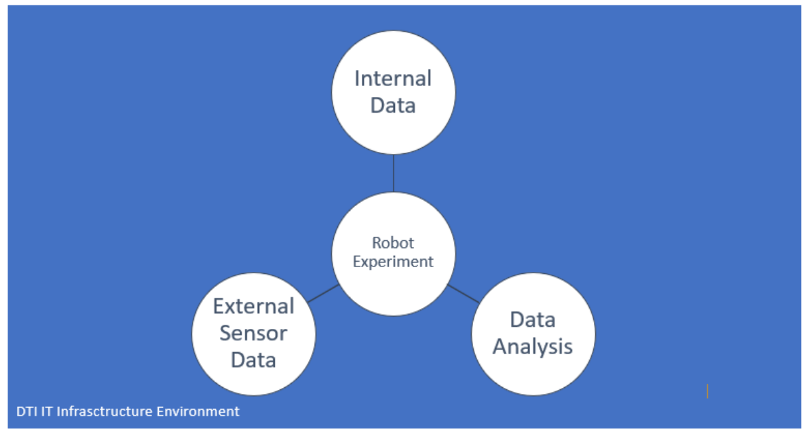
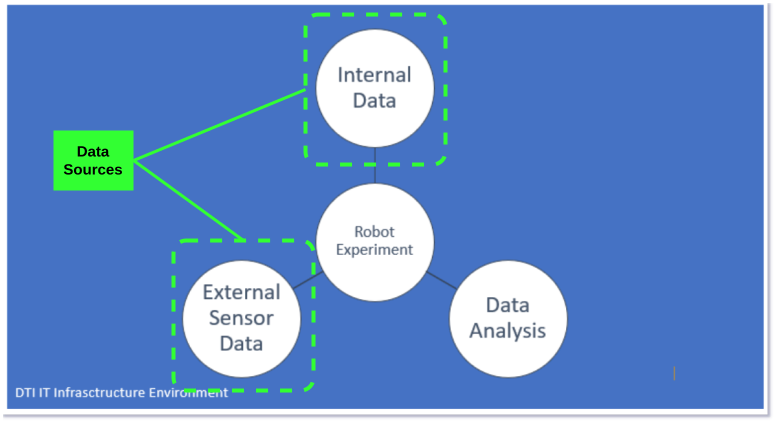

!!! note "Page to be completed"

    The partners of this site have not described it here yet. To add the description, see [Request changes](../../faq/pull_request_procedure.md).

## Infrastructure Components

<table>
  <tr>
    <th colspan="2" style="text-align: center;">Specifications</th>
  </tr>
  <tr>
    <td><strong>Data Broker<strong></td>
    <td>
      &lt;no_specified\> 
      <strong>- API:</strong>&lt;no_specified\> 
      <strong>- Version:</strong>&lt;no_specified\>
    </td>
  </tr>
  <tr>
    <td><strong>Data Source<strong></td>
    <td><&lt;no_specified\></td>
  </tr>
  <tr>
    <td><strong>IdM &amp; Auth<strong></td>
    <td>&lt;no_specified\></td>
  </tr>
  <tr>
    <td><strong>Data Publication<strong></td>
    <td>&lt;no_specified\></td>
  </tr>
</table>

### Architecture

### European Data Space for Smart Communities (DS4SSCC)

{{ config.extra.labels.ds4ssc_compliant.yes_comp.data_sources }} {{ config.extra.labels.ds4ssc_compliant.no_comp.data_broker }} {{ config.extra.labels.ds4ssc_compliant.no_comp.data_api }} {{ config.extra.labels.ds4ssc_compliant.no_comp.data_idm_auth }} {{ config.extra.labels.ds4ssc_compliant.no_comp.data_publication }}

---
!!! info
    This page is part of the documentation hub for the CitCom.ai project. Please ensure that the information is up-to-date and accurate.
