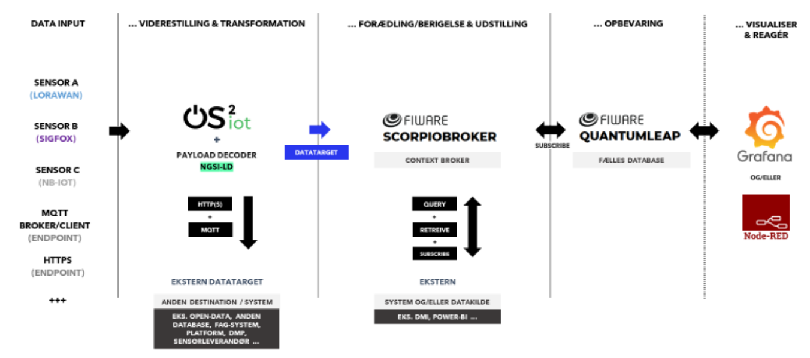

!!! note "Page to be completed"

    The partners of this site have not described it here yet. To add the description, see [Request changes](../../faq/pull_request_procedure.md).

## Infrastructure Components

<table>
  <tr>
    <th colspan="2" style="text-align: center;">Specifications</th>
  </tr>
  <tr>
    <td><strong>Data Broker<strong></td>
    <td>
      {{ config.extra.labels.data_brokers.fiware }} 
      <strong>- API:</strong> {{ config.extra.labels.api_brokers.ngsi_ld }} 
      <strong>- Version:</strong> Scorpio
    </td>
  </tr>
  <tr>
    <td><strong>Data Source<strong></td>
    <td><a href="https://www.os2.eu/os2iot">OS2IoT</a></td>
  </tr>
  <tr>
    <td><strong>IdM &amp; Auth<strong></td>
    <td>&lt;no_specified\></td>
  </tr>
  <tr>
    <td><strong>Data Publication<strong></td>
    <td>&lt;no_specified\></td>
  </tr>
</table>

### Architecture

---
!!! info
    This page is part of the documentation hub for the CitCom.ai project. Please ensure that the information is up-to-date and accurate.
