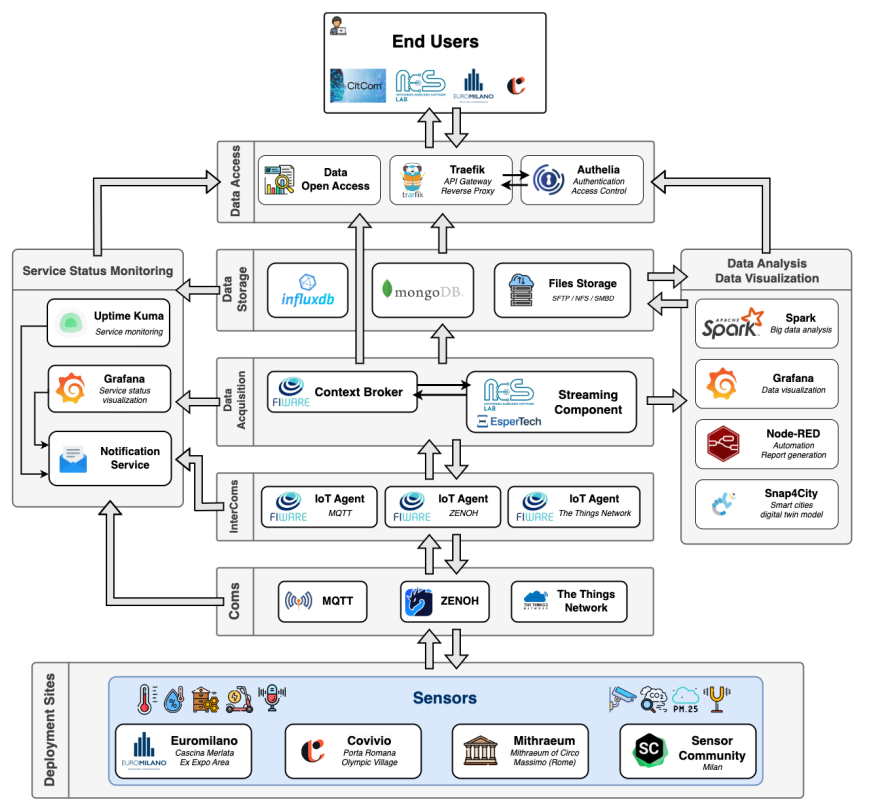

## Overview

The Milano TEF site belongs to the south supernode. It includes two key locations: the UpTown District from Euromilano and the Olympic Village from Covivio.
Both areas sit at the heart of major urban regeneration projects, where public and private stakeholders work together to deliver new buildings that blend housing, commercial, and recreational facilities to improve quality of life and promote environmental sustainability.
The UpTown District rises in the Cascina Merlata area of Milano, the former Expo 20215 venue. It is a modern neighborhood that hosts over 15,000 residents, with housing and services integrated into the urban fabric.
One of Milano's largest parks surrounds the area, offering 300,000 square meters of green space rich in biodiversity.
The Olympic Village is taking shape in Porta Romana, a central district of Milano. It will host athletes during the 2026 Winter Olympic Games before being repurposed for student housing and public use.
These two sites offer a unique opportunity: test advanced AI in the city's heart. From automated monitoring and predictive maintenance to energy optimization, urban planning, and biodiversity tracking, the UpTown District and Olympic Village serve as real-world labs for intelligent facility management at the metropolitan scale.

Politecnico di Milano, Italy's top-ranking technical university, leads the site through the joint work of two departments: DEIB, focused on electronics and information technology, and ABC, focused on architecture, built environment, and construction engineering.
Two key partners ensure a direct connection with the urban landscape. Euromilano, a real estate developer specializing in urban regeneration, manages the UpTown testing areas, providing practical integration of AI solutions in real estate and infrastructure projects.
Covivio contributes expertise in sustainable urban development and innovative facility management.

The Milano TEF site is part of the CitCom.ai project. It features state-of-the-art infrastructure, facilitating collaboration between cities and communities, industrial partners, and research institutions and bringing AI innovation into everyday urban operations.
By combining AI-driven sensor networks, facility automation, and edge/cloud computing solutions, the Milano TEF enables real-world validation of AI technologies, unlocking long-term regeneration projects, boosting sustainability, improving quality of life, and strengthening collaboration between academia, industry, and public stakeholders.

## Services Offered

### IT Services
- **Embedded AI/IoT Sofware Design and Development**: design and development of embedded AI/IoT software for sensing, computing, and communication; including hardware-specific customization. Not necessarily customer-facing.
- **Networking IoT Devices**: design and deployment of low-power wireless sensing technologies, for example, LoRAWAN, including network planning and operation testing. Not necessarily customer-facing.
- **Edge and Cloud Deployment**: design and development of edge and cloud software, possibly including concrete operation on Politecnico's data center, enabling efficient and large-scale execution of AI processing. Not necessarily customer-facing.
- **Time Series Storage and Sharing**: storage and sharing of temporal data from client-specified or public sources, enabling accesses on time series datasets.
- **FIWARE Big Data Processing**: deployment of our FIWARE custom component that enables aggregation and computation of custom metrics based on big data collected from sensors.
- **Large-scale Distributed Sensing**: design and deployment of large scale distributed sensing facilities, accounting for requirements of the deployment locations where specific sampling may be necessary.
- **Bare-metal Compute**: deployment and access to a bare-metal computing infrastructure hosted in Politecnico di Milano, which provides full control on infrastructure configuration, components, and offers various customization options.

### Facility Management Services
- **Integration of Facilities in Terms of Management**: creation of a framework for tender documents, which includes a comprehensive needs analysis developed using the Kano model to help define priorities for public administrations, asset owners, building managers, and facility managers. The framework supports the preparation of tenders for the integrated management of building facilities and neighborhoods. By unifying facilities under a single tender, it enables more efficient service delivery and better coordination across different operational areas.
- **Global service approach**: creation of a detailed inventory of all services provided by the project’s creators and providers, grouping them into services for individuals, businesses, and buildings or neighborhoods. This structured mapping unlocks the identification of the services that align best with the needs of key clients such as Facility Management companies, Asset Management firms, Property companies, Utility providers, and Municipalities.
- **Feasibility of the implementation of a service for the Italian market**: study of the legal and technical, feasibility of implementing client's services designed and tested abroad for the Italian market. This enables the creation of a framework for local testing and certification path, if required. The service will be provided considering the time-cost-quality triangle.
- **Market Attractiveness Study of Services for the Italian Market**: study of the commercial and market viability of the client's services for the local Italian market.

## Infrastructure Components

Milano TEF site uses the following technologies:

- **Data visualization**: Grafana, Apache2 webserver with custom web pages
- **Data transmission and interconnection**: MQTT, The Things Network (LoRaWAN), FIWARE
- **Data processing and automations**: NodeRED, Apache Spark
- **Database**: InfluxDB, MySQL/MariaDB, MongoDB
- **AI Tools**: Tensorflow, PyTorch 
- **Virtualization**: Proxmox, Docker
- **Specific Hardware**: Raspberry PIs, bare-metal servers, customized sensors hardware

<table>
  <tr>
    <th colspan="2" style="text-align: center;">Specifications</th>
  </tr>
  <tr>
    <td><strong>Data Broker<strong></td>
    <td>
      {{ config.extra.labels.data_brokers.fiware }} 
      <strong>- API:</strong> {{config.extra.labels.api_brokers.ngsi_v2}} 
      <strong>- Version:</strong> Orion
    </td>
  </tr>
  <tr>
    <td><strong>Data Source<strong></td>
    <td>&lt;no_specified></td>
  </tr>
  <tr>
    <td><strong>IdM &amp; Auth<strong></td>
    <td>&lt;no_specified></td>
  </tr>
  <tr>
    <td><strong>Data Publication<strong></td>
    <td>&lt;no_specified></td>
  </tr>
</table>

### Architecture

Milano TEF infrastructure enables seamless integration and real-time processing of IoT data across multiple urban deployment sites located in Italy.
The sensors deployed in Cascina Merlata, Porta Romana, and the Mithraeum of Rome transmit data using heterogeneous communication protocols (MQTT, ZenoH, and LoRaWAN via The Things Network).
Data incoming from our site locations is unified by corresponding FIWARE IoT Agents and delivered to a central FIWARE Context Broker, representing our infrastructure's central data exchange location.
Our infrastructure supports reliable data storage (InfluxDB, MongoDB), continuous analytics, data aggregation using our custom streaming component (EsperTech), and access through Traefik and authentication layers.
Finally, visualization and analysis tools (Grafana, Spark, Node-RED, Snap4City) enable real-time monitoring of our infrastructure and allow end users to extract environmental conditions insights, urban infrastructure usage, and system health.

## Relevant datasets of the site

Milano TEF site offers the following datasets:

- **[Air quality](#datasets-in-detail)**: air quality readings from sensors deployed across the Milano area, reporting temperature, humidity, and pollutant levels along with time and location.
- **[Biodiversity](#datasets-in-detail)**: data from biodiversity sensors deployed in UpTown, reporting device status, energy levels, and bird species detections over time.
- **[Energy distribution](#datasets-in-detail)**: data from heating systems deployed in UpTown, reporting energy use, fluid temperatures, and heating power.
- **[Archaeological site](#datasets-in-detail)**: environmental data from sensors deployed in an underground archaeological site, reporting air quality, temperature, humidity, and vibration levels over time.

## Key Stakeholders and Partners

- **Euromilano**: real estate development and consulting company, established in Milan in 1986. The company specializes in forward-thinking urban regeneration and sustainable building projects, collaborating with governments, investors, and corporate partners to create secure, green, and socially engaging spaces that prioritize quality and functionality.
- **Yes Milano, Promos Milano, Chamber of Commerce**: Milano FDI ecosystem that is working on the promotion and Foreign Direct Investments attraction in Milano and Lombardia Region together with the Regional Government. The industrial ecosystem integration will be a key success factor for CitCom.AI in terms of Companies involved into TEF’s activity. 
- **Ministero delle Infrastrutture (MIT)**: the Italian Infrastrcutre Ministry. They are keen to support CitCom.AI as part of a wider vision on digitalization of the italian nation, thanks to the cooperation with members of European Parliament and Italian Parliament who endorsed the CitCom.AI mission. Several support services has been provided such as assistance on State Aid rules, open to all the members of the CitCom.AI consortium.

## Contact Information

- **Site Coordinator**: Luca Mottola <luca.mottola@polimi.it>
- **Technical Support**: Andrea Maioli <andrea1.maioli@polimi.it>
- **General Inquiries**: Alberto Celani <alberto.celani@polimi.it>

## Datasets in detail

Attributes of the datasets of this site, as described by its partners.

??? info "AirQuality"

    | ATTRIBUTE    | TYPE     | UNITS (SI)   | DESCRIPTION/COMMENTS                      |
    |:-------------|:---------|:-------------|:------------------------------------------|
    | id           | Text     |           | Sensor identifier                         |
    | temperature  | Number   | K            | Ambient temperature                       |
    | humidity     | Number   | %            | Relative humidity                         |
    | co           | Number   | mg/m³        | Carbon monoxide concentration             |
    | nh3          | Number   | µg/m³        | Ammonia concentration                     |
    | no           | Number   | µg/m³        | Nitric oxide concentration                |
    | no2          | Number   | µg/m³        | Nitrogen dioxide concentration            |
    | o3           | Number   | µg/m³        | Ozone concentration                       |
    | pm25         | Number   | µg/m³        | Particulate matter < 2.5 µm concentration |
    | pm10         | Number   | µg/m³        | Particulate matter < 10 µm concentration  |
    | so2          | Number   | µg/m³        | Sulfur dioxide concentration              |
    | indoor       | Boolean  |           | True if the sensor is located indoors     |
    | manufacturer | Text     |           | Sensor manufacturer name                  |
    | sensorName   | Text     |           | Human-readable sensor name                |
    | location     | geo:json |           | Geographical coordinates of the sensor    |
    | timestamp    | Number   |           | Unix timestamp of the measurement         |

??? info "Biodiversity"

    | ATTRIBUTE                      | TYPE   | UNITS (SI)   | DESCRIPTION/COMMENTS                        |
    |:-------------------------------|:-------|:-------------|:--------------------------------------------|
    | id                             | Text   |           | Sensor identifier                           |
    | timestamp                      | Number |           | Unix timestamp of the measurement           |
    | device_hostname                | Text   |           | Device hostname                             |
    | firmware_version               | Text   |           | Current firmware version                    |
    | state                          | Text   |           | Reported high-level state of the device     |
    | activity_state                 | Text   |           | Current activity state (e.g., active, idle) |
    | device_temperature             | Number | °C          | Internal device temperature                 |
    | battery_voltage                | Number | V            | Battery voltage                             |
    | battery_level                  | Number | %            | Battery charge level                        |
    | battery_power_input            | Text   |           | Raw battery input power data                |
    | last_ping                      | Number |           | Timestamp of last device ping               |
    | last_audio_record              | Number |           | Timestamp of last audio recording           |
    | last_detection_ts              | Number |           | Timestamp of last detection event           |
    | last_detection_scientific_name | Text   |           | Scientific name of last detected species    |
    | last_detection_common_name_en  | Text   |           | Common name (EN) of last detected species   |
    | last_detection_common_name_it  | Text   |           | Common name (IT) of last detected species   |
    | last_detection_confidence      | Number |           | Confidence score of last detection          |

??? info "Energy distribution"

    | ATTRIBUTE                    | TYPE     | UNITS (SI)   | DESCRIPTION/COMMENTS                                         |
    |:-----------------------------|:---------|:-------------|:-------------------------------------------------------------|
    | id                           | Text     |           | Sensor identifier                                            |
    | timestamp                    | Number   |           | Unix timestamp of the measurement                            |
    | user_identifier              | Text     |           | Anonymized unique identifier for the user                    |
    | pod_identifier               | Number   |           | Anonymized identifier of the heating POD unit                |
    | pod_coordinates              | geo:json |           | Geographical coordinates of the POD                          |
    | user_type                    | Text     |           | Category or role of the user (e.g., residential, commercial) |
    | external_temperature         | Number   | °C           | Outdoor air temperature                                      |
    | heating_temperature_delivery | Number   | °C           | Temperature of the fluid delivered to the heating system     |
    | heating_temperature_return   | Number   | °C           | Temperature of the fluid returning from the heating system   |
    | heating_volume               | Number   | m³/h         | Volume flow rate of heating fluid                            |
    | heating_power                | Number   | kW           | Thermal power delivered for heating                          |
    | energy_consumption           | Number   | kWh          | Cumulative heating energy consumed                           |

??? info "Archaeological Site"

    | ATTRIBUTE     | TYPE     | UNITS (SI)   | DESCRIPTION/COMMENTS                      |
    |:--------------|:---------|:-------------|:------------------------------------------|
    | id            | Text     |           | Sensor identifier                         |
    | temperature   | Number   | K            | Ambient temperature                       |
    | humidity      | Number   | %            | Relative humidity                         |
    | pm10          | Number   | µg/m³        | Particulate matter < 10 µm concentration  |
    | pm25          | Number   | µg/m³        | Particulate matter < 2.5 µm concentration |
    | spectralPower | Number   | mW/Hz        | Spectral power density of vibrations      |
    | timestamp     | Number   |           | Unix timestamp of the measurement         |
    | location      | geo:json |           | Geographical coordinates of the sensor    |

---

!!! info
    This page is part of the documentation hub for the CitCom.ai project. Please ensure that the information is up-to-date and accurate.
