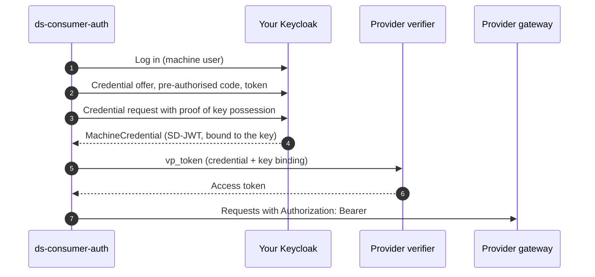

# ds-consumer-auth

[Repository :simple-github:](https://github.com/CitComAI-Hub/ds-consumer-auth){ .md-button .md-button--primary }

**ds-consumer-auth** is a Python library, made in CitCom, that gets the access token of a FIWARE data space for a program. It hides the whole credential flow behind a `requests` session: the token is obtained, cached, renewed before it expires, and a request that gets a `401` is retried once with a new token.

```python
from ds_consumer_auth import data_space_session

session = data_space_session()  # configured with DS_* environment variables
response = session.get(
    "https://apisix-townhall-vlc.citcom-vrain-dataspace.eu/lepus/ngsi-ld/v1/entities",
    params={"type": "WasteContainer"},
)
```

It works with any client built on `requests`, such as [FiLiP](ngsi_ld.md).

## What it does for you



Steps 1 to 4 follow [OID4VCI](https://openid.net/specs/openid-4-verifiable-credential-issuance-1_0.html) against Keycloak 26.6; the credential is valid for long and kept in memory. Step 5 presents it to the provider's verifier. Tested against the CitCom data space (FIWARE Data Space Connector 10).

## Install and configure

```bash
pip install "ds-consumer-auth @ git+https://github.com/CitComAI-Hub/ds-consumer-auth@v0.1.0"
```

| Variable | Required | Description |
|---|---|---|
| `DS_ISSUER_URL` | yes | Credential issuer of your organisation, e.g. `https://keycloak-vrain.citcom-vrain-dataspace.eu/realms/provider` |
| `DS_USERNAME`, `DS_PASSWORD` | yes | Machine user that holds the credential |
| `DS_VERIFIER_URL` | yes | Verifier service of the provider, e.g. `https://verifier-townhall-vlc.citcom-vrain-dataspace.eu/services/machine-id` |
| `DS_SCOPE` | no | Scope asked to the verifier, e.g. `operator1` |
| `DS_CREDENTIAL_TYPE` | no | `MachineCredential` by default |
| `DS_HOLDER_KEY_FILE` | no | Key of the holder, to keep the same one across restarts |

The [repository](https://github.com/CitComAI-Hub/ds-consumer-auth#configuration) lists all of them.

From the shell, `ds-token` prints a token, handy to test with `curl`:

```bash
curl -H "Authorization: Bearer $(ds-token)" "https://apisix-townhall-vlc.citcom-vrain-dataspace.eu/ngsi-ld/v1/entities?type=TrafficState&limit=1"
```

## Before it works

The provider's verifier only accepts your credential if your organisation **bought one of its offers** in the marketplace. The guide [Use data from your code](../guides/consume_data.md) covers the whole process and the errors.

## Limitations

- One provider per session: create one session per provider.
- Login with a user and password; client credentials and certificates are not supported yet.
- Only for FIWARE data spaces. For Eclipse EDC, see [Bridging both](../data_spaces/bridge.md).
