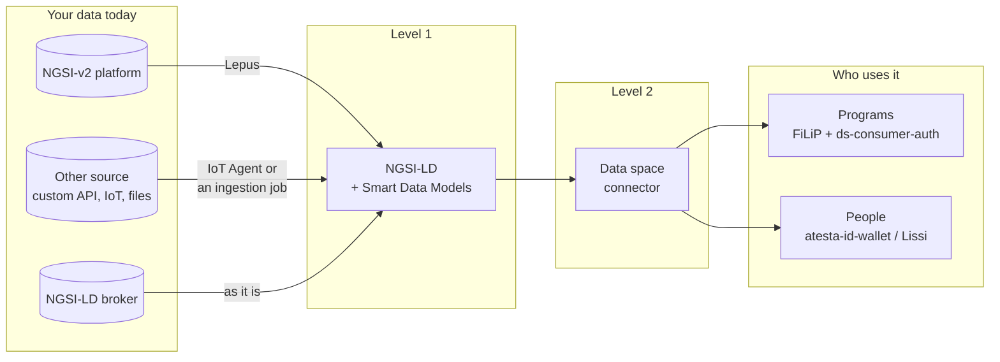

# Toolbox

Open-source tools to bring city data to the data space and use it from your code. Several are made in CitCom.

  <article class="cc-tool">
    <h3>Lepus</h3>
    
For city platforms A CitCom fork

    
Serve an NGSI-v2 platform as NGSI-LD with Smart Data Models, live and without migrating it.

    
<a class="cc-tool__go" href="lepus/">Read the guide</a><a class="cc-tool__ext" href="https://github.com/CitComAI-Hub/lepus" target="_blank" rel="noopener">GitHub</a>

  </article>
  <article class="cc-tool">
    <h3>ds-consumer-auth</h3>
    
For developers Made in CitCom

    
Get the access token of the data space from Python. One line, and it is renewed for you.

    
<a class="cc-tool__go" href="ds_consumer_auth/">Read the guide</a><a class="cc-tool__ext" href="https://github.com/CitComAI-Hub/ds-consumer-auth" target="_blank" rel="noopener">GitHub</a>

  </article>
  <article class="cc-tool">
    <h3>Wallets</h3>
    
For everyone Made in CitCom

    
Keep your credentials and log in with a QR code: atesta-id-wallet on the desktop, Lissi ID Wallet on the phone.

    
<a class="cc-tool__go" href="wallets/">Read the guide</a><a class="cc-tool__ext" href="https://github.com/CitComAI-Hub/atesta-id-wallet" target="_blank" rel="noopener">GitHub</a>

  </article>
  <article class="cc-tool">
    <h3>NGSI-LD and FiLiP</h3>
    
For developers

    
The NGSI-LD calls you need most, and FiLiP to make them from Python against any broker.

    
<a class="cc-tool__go" href="ngsi_ld/">Read the guide</a><a class="cc-tool__ext" href="https://github.com/RWTH-EBC/FiLiP" target="_blank" rel="noopener">GitHub</a>

  </article>
  <article class="cc-tool">
    <h3>Smart Data Models</h3>
    
For data providers

    
The shared vocabulary of city data: entity types, attributes and units that every city reads the same way.

    
<a class="cc-tool__go" href="smart_data_models/">Read the guide</a><a class="cc-tool__ext" href="https://smartdatamodels.org/" target="_blank" rel="noopener">Website</a>

  </article>

Built something that helps CitCom partners? [Propose your tool with a pull request](../faq/pull_request_procedure.md).

## More tools

<ul class="cc-rows cc-rows--two" markdown="0">
  <li><a href="ai_toolkit/"><strong>AI Toolkit</strong>Frameworks and projects to build and manage AI services</a></li>
  <li><a href="ai_logging_monitor/"><strong>AI Logging Monitor</strong>Log and monitor the behaviour of an AI system</a></li>
  <li><a href="mims_toolkit/"><strong>MIMs Toolkit</strong>Tools to comply with the OASC Minimal Interoperability Mechanisms</a></li>
  <li><a href="ldt_toolkit/"><strong>LDT Toolkit</strong>A deployable demonstrator of interoperable local digital twins</a></li>
  <li><a href="iot_agent/"><strong>FIWARE IoT Agent</strong>An experiment: NGSI-v2 to NGSI-LD through subscriptions</a></li>
  <li><a href="other_toolkit/"><strong>Other tools</strong>Grafana plugin, NGSI-LD clients and more</a></li>
</ul>

## Where each tool fits

Which tools you need depends on where your data is today. Whatever the starting point, the path is the same: reach [interoperability level 1](../getting_started/interoperability.md#level-1) (NGSI-LD and Smart Data Models), put a connector in front for level 2, and let programs and people use the data.

For example, a city with an NGSI-v2 platform puts Lepus in front of it and publishes it through its connector; the [Valencia example](../valencia/index.md) shows it step by step.
