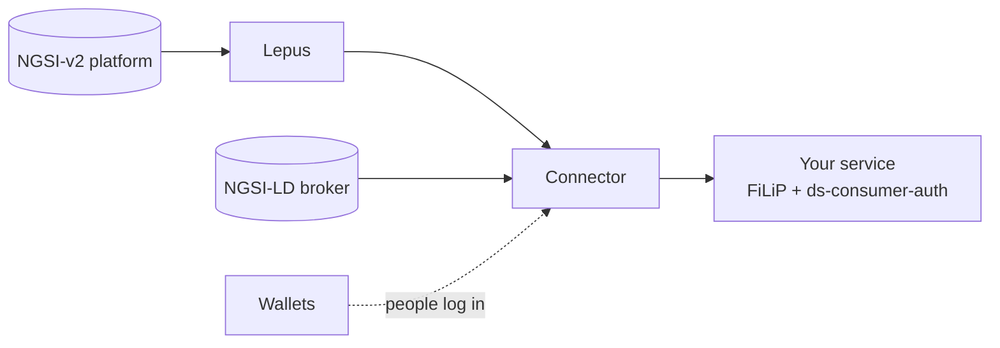

# Toolbox

The tools used in the CitCom data space, from the city platform to the AI service. All of them are open source.

-   :material-swap-horizontal:{ .lg .middle } __Lepus__

    ---

    Serve an NGSI-v2 platform as NGSI-LD, without migrating it.

    [:octicons-arrow-right-24: Lepus](lepus.md)

-   :material-language-python:{ .lg .middle } __NGSI-LD and FiLiP__

    ---

    Query a context broker from Python.

    [:octicons-arrow-right-24: NGSI-LD and FiLiP](ngsi_ld.md)

-   :material-key-chain-variant:{ .lg .middle } __ds-consumer-auth__

    ---

    Get the access token of the data space from your code.

    [:octicons-arrow-right-24: ds-consumer-auth](ds_consumer_auth.md)

-   :material-wallet-outline:{ .lg .middle } __Wallets__

    ---

    Keep your credentials and log in with a QR code: Lissi ID Wallet and atesta-id-wallet.

    [:octicons-arrow-right-24: Wallets](wallets.md)

-   :material-shape-outline:{ .lg .middle } __Smart Data Models__

    ---

    The data models used in the CitCom data spaces.

    [:octicons-arrow-right-24: Smart Data Models](smart_data_models.md)

## More tools

Other tools collected by the project partners: [AI toolkit](ai_toolkit.md), [AI logging monitor](ai_logging_monitor.md), [MIMs toolkit](mims_toolkit.md), [LDT toolkit](ldt_toolkit.md), the [FIWARE IoT Agent](iot_agent.md) experiment and [other tools](other_toolkit.md).
