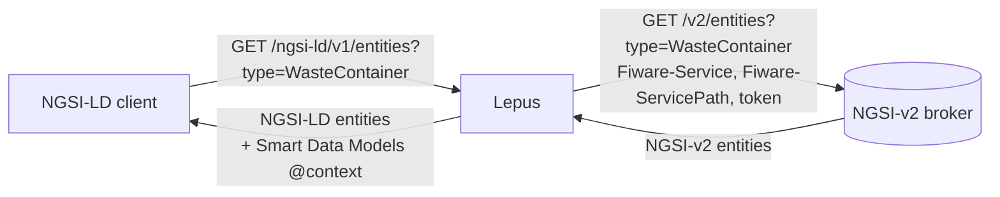

# Lepus

[Repository :simple-github:](https://github.com/CitComAI-Hub/lepus){ .md-button .md-button--primary }

**Lepus** serves the data of an **NGSI-v2** context broker as **NGSI-LD**. It is the shortcut to [interoperability level 1](../getting_started/interoperability.md#level-1-pivotal-interoperability-points) for a city that already runs an NGSI-v2 platform: no migration, no copy of the data. Each NGSI-LD request is translated to NGSI-v2, sent to the platform, and the answer is translated back.

CitCom maintains a [fork](https://github.com/CitComAI-Hub/lepus) of the FIWARE [Lepus](https://github.com/jason-fox/lepus), used by the Ajuntament de València to serve its VLCi platform in the data space.



## What the CitCom fork adds

| Feature | Why |
|---|---|
| **Keystone authentication** | Lepus gets its own token from the platform (Keystone v3), cached until it expires. The data space token of the client never reaches the platform. |
| **Tenant and service path** | NGSI-LD has no service path. Lepus deduces it from the entity type with a map, and uses a default tenant when the request has none. |
| **URN ids** | Platform ids that are not URNs (`wastecontainer:6205…`) are returned as `urn:ngsi-ld:WasteContainer:wastecontainer:6205…`, also with `options=keyValues`, and can be read back with that id. |
| **Smart Data Models `@context`** | Each entity comes with the `@context` of its Smart Data Models subject, e.g. `dataModel.WasteManagement` for `WasteContainer`. The list of models is downloaded once a day. |
| **Timeouts** | The timeouts to the platform apply to every request. |
| **Container image** | `ghcr.io/citcomai-hub/lepus`, one tag per release. |

## Use it

Lepus is an HTTP service configured with environment variables; the main ones:

| Variable | Description |
|---|---|
| `NGSI_V2_CONTEXT_BROKER` | URL of the NGSI-v2 broker |
| `AUTH_URL`, `AUTH_USER`, `AUTH_PASSWORD` | Keystone of the platform, if it needs authentication |
| `LEPUS_DEFAULT_TENANT` | Tenant (`Fiware-Service`) when the request has no `NGSILD-Tenant` |
| `LEPUS_SERVICE_PATHS` | Map from entity type to service path |
| `NGSI_V2_PLAIN_IDS` | `true` if the platform ids are not URNs |
| `NGSI_V2_TIMEOUT` | Timeout of each request to the platform, in milliseconds |

The [repository](https://github.com/CitComAI-Hub/lepus) has the full list, a `docker compose` setup to try it and Kubernetes manifests.

In a data space, place Lepus behind your connector's gateway like any other broker, on its own path, with the same token check and policy engine. In Valencia it is `/lepus/ngsi-ld/*`:

```bash
curl -s -H "Authorization: Bearer $TOKEN" -H "Accept: application/ld+json" \
  "https://apisix-townhall-vlc.citcom-vrain-dataspace.eu/lepus/ngsi-ld/v1/entities?type=WasteContainer&limit=1"
```

## Limitations

- It supports reading and writing entities, subscriptions, types, attributes and most batch operations; `entityOperations/query` and `merge` are not supported.
- When an entity type lives in several service paths, only the first one is used.
- Queries are as fast as the platform behind it: every request goes to the platform.

!!! info "Another option: the IoT Agent"

    A FIWARE IoT Agent can also bridge NGSI-v2 and NGSI-LD, by copying the data through subscriptions. CitCom tested it and chose Lepus because it does not duplicate the data. See the [IoT Agent experiment](iot_agent.md).
