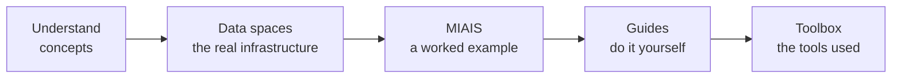

# Understand CitCom

This section explains, in plain words, what CitCom.ai is and why its technical pieces fit together the way they do. Read it first if you are new to the project. Each page is short and links to the deeper chapters.

## CitCom in four questions

**What is it?**
:   [CitCom.ai](https://citcom.ai) is a European Union project that runs Testing and Experimentation Facilities (TEFs) for AI and robotics in smart and sustainable cities. A company brings an AI product and tests it in real cities, with real data, before it reaches the market. → [The project and the TEFs](project.md)

**What does it build on?**
:   On the European work on data sharing between cities: the [Minimal Interoperability Mechanisms](interoperability.md#mims) (MIMs) of OASC, the [Smart Data Models](https://smartdatamodels.org/) and the data space recommendations of the [Data Spaces Support Centre](https://dssc.eu/) and [DS4SSCC](https://www.ds4sscc.eu/). → [Interoperability](interoperability.md)

**Which technology does it use?**
:   NGSI-LD context brokers to serve the data, Smart Data Models to describe it, and two data space technologies to share it under control: the [FIWARE Data Space Connector](../data_spaces/fiware.md) and [Eclipse EDC](../data_spaces/eclipse/index.md). Access is granted with verifiable credentials held in a wallet. → [Data spaces in 5 minutes](data_spaces.md)

**What does it offer a TEF?**
:   A *minimal package*: a shared reference architecture, a working data space to join, tools to connect existing city platforms, a worked example of an interoperable AI service, and the [AI Trustworthiness Label](../ai_assessment/index.md) to assess the services that are tested.

## The path through this site

1. **Understand** the concepts (this section).
2. See **the real infrastructure**: [the CitCom data spaces](../data_spaces/index.md) and the [Valencia TEF node](../valencia/index.md).
3. Follow **a worked example**: the [MIAIS](../miais/index.md), an AI service that climbs the interoperability levels one by one.
4. **Do it yourself** with the [guides](../guides/index.md): get a wallet, join, read data, publish data or a service.
5. Use the **[toolbox](../toolbox/index.md)**: Lepus, FiLiP, ds-consumer-auth and the wallets.
