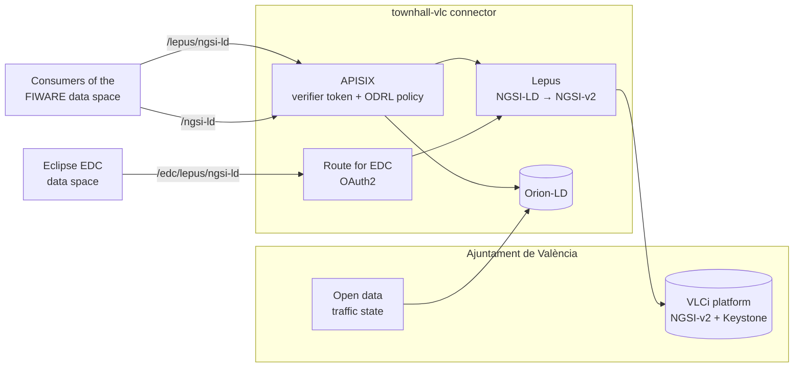

# Valencia: a city platform in the data space

The **Ajuntament de València** (City Council) was one of the first participants of the [FIWARE data space](../data_spaces/fiware.md). Its case is the reference for a city that already runs an urban platform and wants to offer that data to other organisations, without migrating the platform or copying the data.

Where the [MIAIS](../miais/index.md) shows the side of an AI service, this example shows the side of a **data provider**.

## The starting point

The city data lives in **VLCi**, the urban platform of the Ajuntament: an NGSI-v2 broker protected by Keystone, with its own data models. The goal was to reach [interoperability level 2](../getting_started/interoperability.md): the same data, as NGSI-LD with [Smart Data Models](../toolbox/smart_data_models.md), bought and accessed through the data space.

The steps were:

1. **Join the data space** as the participant `townhall-vlc`, with its own connector. See [Join the data space](../guides/join.md).
2. **Serve VLCi as NGSI-LD** with [Lepus](../toolbox/lepus.md) inside the connector, so that VLCi stays as it is.
3. **Publish one offer per dataset** in the marketplace, each limited to its entity type. See [Publish a dataset](../guides/publish_dataset.md).

## Data in the data space

The Ajuntament offers four datasets in the [marketplace](../marketplace/index.md), one offer each, all as NGSI-LD with [Smart Data Models](../toolbox/smart_data_models.md):

| Dataset | Entity type | Source | Endpoint path | Category |
|---|---|---|---|---|
| Waste containers | [`WasteContainer`](https://github.com/smart-data-models/dataModel.WasteManagement/tree/master/WasteContainer) | VLCi, through Lepus | `/lepus/ngsi-ld` | Waste management |
| Air quality | [`AirQualityObserved`](https://github.com/smart-data-models/dataModel.Environment/tree/master/AirQualityObserved) | VLCi, through Lepus | `/lepus/ngsi-ld` | Environment |
| Traffic flow | [`TrafficFlowObserved`](https://github.com/smart-data-models/dataModel.Transportation/tree/master/TrafficFlowObserved) | VLCi, through Lepus | `/lepus/ngsi-ld` | Mobility |
| Traffic state | `TrafficState` | VLCi open data | `/ngsi-ld` | Mobility |

The endpoints are under `https://apisix-townhall-vlc.citcom-vrain-dataspace.eu`. Each offer gives access to its entity type only, with a `MachineCredential`. To use them, follow [Use data from your code](../guides/consume_data.md).

## How the data flows

- **Lepus** serves the VLCi data live. It translates each NGSI-LD query into NGSI-v2, authenticates with the city platform on its own, and returns the entities as NGSI-LD with their Smart Data Models `@context`. VLCi never sees the data space tokens, and nothing is copied. See [Lepus](../toolbox/lepus.md).
- **APISIX** protects every path with the same mechanism: a token from the verifier and the ODRL policy of the purchased offer.
- The same Lepus also serves the [Eclipse EDC data space](../data_spaces/eclipse/index.md), through its own route. See [Bridging both](../data_spaces/bridge.md).

## Who uses this data

| Service | Provider | What it does |
|---|---|---|
| [MIAIS Waste Collection](../miais/index.md) | VRAIN | Plans waste collection routes from the filling level of the Valencia containers. It reads the containers through the data space, and other organisations can use it by logging in with a wallet. |

## Do the same in your city

- An NGSI-v2 platform: put [Lepus](../toolbox/lepus.md) in front of it, as here.
- An NGSI-LD broker already: publish it directly through your connector.
- Another kind of platform: see [NGSI-LD and FiLiP](../toolbox/ngsi_ld.md) and the [other tools](../toolbox/index.md) to bring it to NGSI-LD.

Then follow the guides from [Get a wallet](../guides/wallet.md) to [Publish a dataset](../guides/publish_dataset.md). The Valencia TEF site itself is described in [TEF network](../tef/south_connect/valencia.md).
