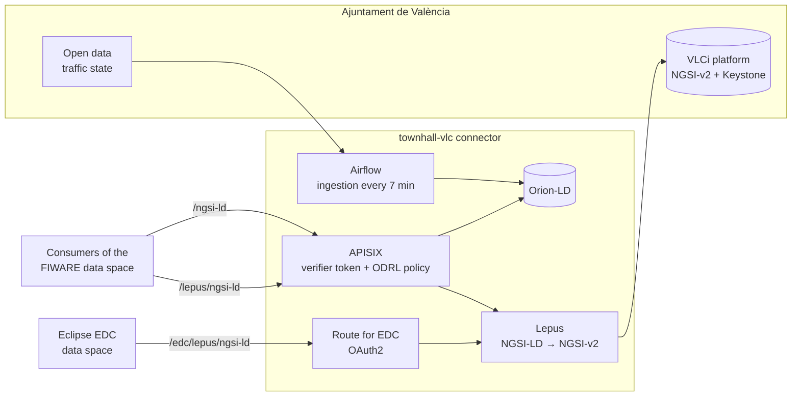

# Valencia TEF node

Valencia is a site of the South super-node (CONNECT). It supports AI innovation in pollution, noise, waste and water management, mobility, urban development and tourism, and it hosts the [FIWARE data space](../data_spaces/fiware.md) of CitCom.

## Who is who

| Organisation | Role in the TEF | In the data space |
|---|---|---|
| **Ajuntament de València** (City Council) | Owns the city data, through the **VLCi** urban platform | Provider `townhall-vlc`: offers the city datasets |
| **València Innovation Capital** | Innovation hubs: Las Naves and La Harinera, the Urban Sandbox for AI | — |
| **VRAIN-UPV** (Universitat Politècnica de València) | AI research and development; operates the data space | Participant `vrain`: offers the [MIAIS](../miais/index.md) and consumes city data |

## Services for companies

- **Dissemination of AI activities**: workshops, webinars and presentations that showcase the innovations tested in Valencia.
- **Development and testing of AI algorithms**: the universities of the consortium help startups and research centres develop and validate their algorithms, with attention to data privacy and optimisation.
- **City data**: real-time data from the VLCi platform, now offered through the data space (below). An independent instance of VLCi was also set up for CitCom partners to experiment in a controlled environment.
- **Regulatory support**: the Urban Sandbox for AI helps test in real conditions and check compliance; S2Grupo provides cybersecurity services.

## Data in the data space

The Ajuntament offers four datasets in the [marketplace](../marketplace/index.md), one offer each, all as NGSI-LD with [Smart Data Models](../toolbox/smart_data_models.md):

| Dataset | Entity type | Source | Endpoint path | Category |
|---|---|---|---|---|
| Waste containers | [`WasteContainer`](https://github.com/smart-data-models/dataModel.WasteManagement/tree/master/WasteContainer) | VLCi, through Lepus | `/lepus/ngsi-ld` | Waste management |
| Air quality | [`AirQualityObserved`](https://github.com/smart-data-models/dataModel.Environment/tree/master/AirQualityObserved) | VLCi, through Lepus | `/lepus/ngsi-ld` | Environment |
| Traffic flow | [`TrafficFlowObserved`](https://github.com/smart-data-models/dataModel.Transportation/tree/master/TrafficFlowObserved) | VLCi, through Lepus | `/lepus/ngsi-ld` | Mobility |
| Traffic state | `TrafficState` | VLCi open data endpoint, loaded every 7 minutes | `/ngsi-ld` | Mobility |

The endpoints are under `https://apisix-townhall-vlc.citcom-vrain-dataspace.eu`. Each offer gives access to its entity type only, with a `MachineCredential`. To use them, follow [Use data from your code](../guides/consume_data.md).

## How the data flows

- **Lepus** serves the VLCi data live. It translates each NGSI-LD query into NGSI-v2, authenticates with the city platform on its own, and returns the entities as NGSI-LD with their Smart Data Models `@context`. VLCi never sees the data space tokens, and nothing is copied. See [Lepus](../toolbox/lepus.md).
- **Airflow** loads the traffic state from an open data endpoint of VLCi into an Orion-LD broker every 7 minutes, for data that is not in VLCi.
- **APISIX** protects both paths with the same mechanism: a token from the verifier and the ODRL policy of the purchased offer.
- The same Lepus also serves the [Eclipse EDC data space](../data_spaces/bridge.md), through its own route.

## Services in the data space

| Service | Provider | What it does |
|---|---|---|
| [MIAIS Waste Collection](../miais/index.md) | VRAIN | Plans waste collection routes from the filling level of the Valencia containers. It reads the containers through the data space, and other organisations can use it by logging in with a wallet. |

## Contact

- **Data space and technical questions**: VRAIN-UPV, through the [GitHub organisation](https://github.com/CitComAI-Hub) of the hub.
- **The TEF and its services**: the [CitCom TEF website](https://citcomtef.eu/).
